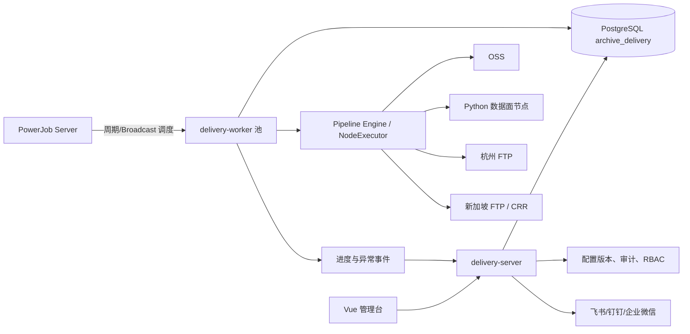
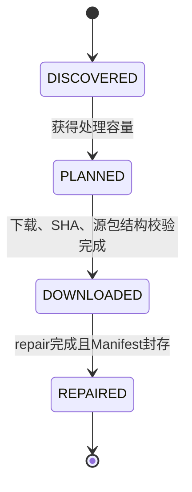
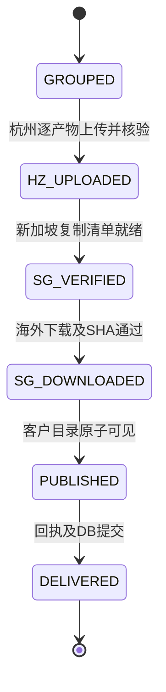
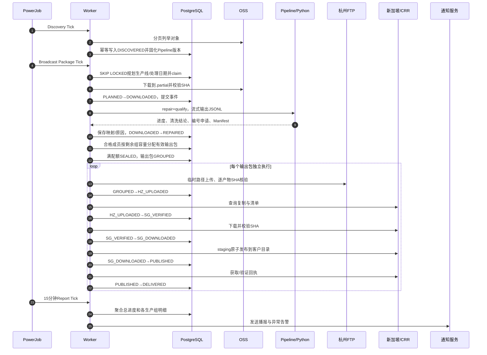
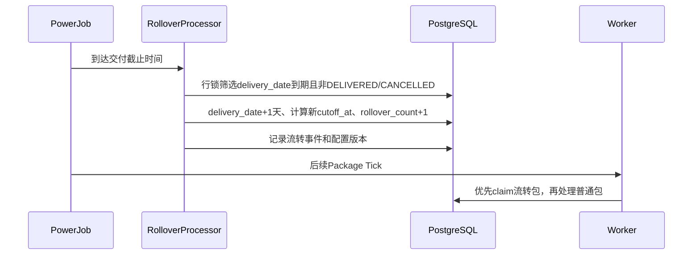
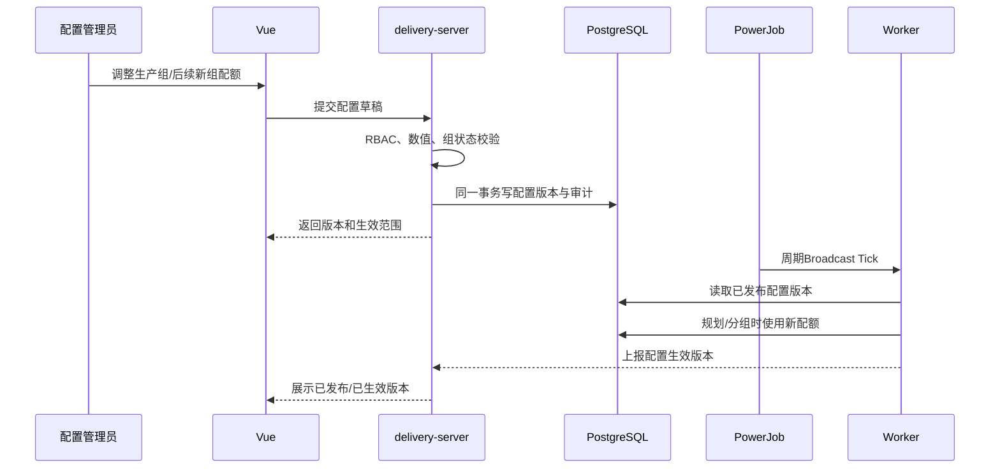
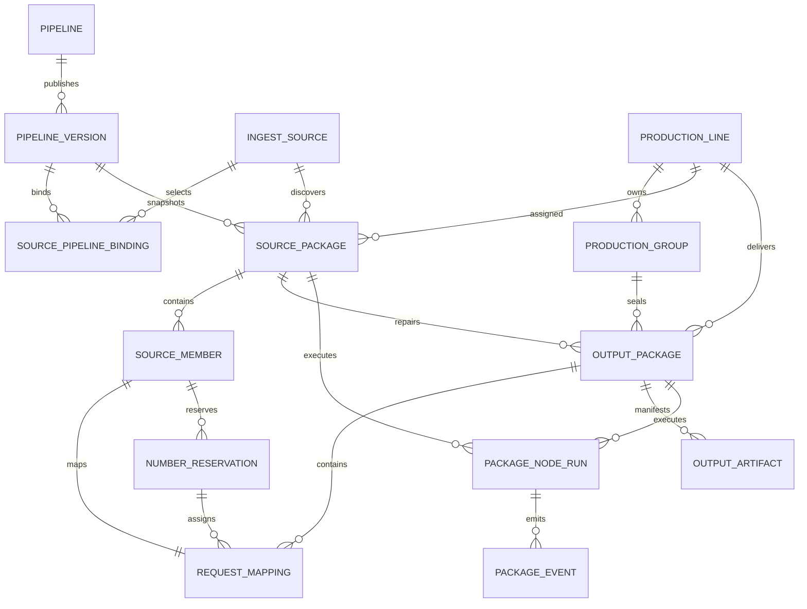

# Archive Delivery Platform 技术设计

## 1. 文档目的与建设边界

本设计用于新建独立项目 `archive-delivery-platform`，将原有归档修复、清洗、分组和三地交付脚本升级为可配置、可观测、可水平扩展的数据交付平台。PowerJob 是底座调度系统，不修改 PowerJob 核心代码，也不把业务状态写入 PowerJob。

建设目标：

1. 以源包、请求成员、有效输出包、生产大组四种粒度记录数据血缘。
2. 以有效输出包作为交付进度和原子重试单位，以生产大组作为配额与汇总单位。
3. 支持 OSS 下载跨天、未接收数据顺延、多个 OSS 数据集混合消费。
4. 用版本化 Pipeline 编排 Java、Python、Shell 节点，支持新协议和新清洗流水线。
5. 支持包明细断点重试、全程事件追踪、异常监控和每 15 分钟进度播报。
6. 前后端同一仓库，提供 PostgreSQL 模型、Vue 看板、Docker 镜像和 Compose 部署。

非目标：

- 不改造旧 `aistore-platform` 业务代码。
- 不用 NiFi、Beam、SeaTunnel 等再建第二套任务执行与状态平台。
- 不让 Python 节点直接更新业务数据库。
- 不允许通过页面执行任意 Shell 命令。
- 不承诺一台 Worker 宕机后其本地临时文件可以在另一台机器无缝续用。

## 2. 原项目流程理解

原流程以 OSS 中的 tar 归档为输入，归档内包含多个 `req_*` 目录，每个目录通常有 `metadata.json`、`biz_request.json` 和响应文件。

原处理链路为：

1. 从 OSS 下载源 tar 包并解包。
2. 按请求目录解析元数据、请求和响应。
3. 修复缺失或不符合目标协议的数据格式。
4. 按 `fix_archive.py` 的最新替换逻辑校准 `requestId`、`providerCode`、`requestTime`，处理 STREAM/SYNC 响应文件并校验输出协议。
5. 按 `package_to_delivery_without_filter.py` 的原始逻辑适配 JSON、映射 platform/token、跳过缺时间或解析失败数据，并处理大文件拆包。
6. 将有效产物按生产大组组织，经杭州 FTP、新加坡复制核验、海外下载、原子发布和回执提交完成交付。

原流程的问题不是单一脚本错误，而是不同粒度共用一个状态，导致无法准确回答：

- 原始请求属于哪个源包，修复后变成哪个文件。
- 哪些数据被哪条规则过滤，规则版本是什么。
- 一个大组中哪个有效输出包失败，能否只重试这个包。
- OSS 未消费数据跨天后归属哪一天。
- 配置修改会影响新包还是已经在运行的包。

## 3. 粒度与术语

| 名词 | 含义 | 主要用途 |
|---|---|---|
| 数据源 `ingest_source` | 一个 OSS 前缀或一次性导入请求 | 绑定 Pipeline |
| 源包 `source_package` | OSS 中的一个原始 tar 包 | 下载、repair、清洗结论 |
| 源成员 `source_member` | 源包内一个请求目录或成员 | 清洗原因、原始定位 |
| 请求映射 `request_mapping` | 原请求与新 requestId、原包与新包的映射 | 血缘追踪 |
| 有效输出包 `output_package` | repair 后一个可独立交付和重试的逻辑包 | 看板进度、原子重试 |
| 产物 `output_artifact` | 输出包中的一个物理文件或分片 | SHA、三地路径 |
| 生产大组 `production_group` | 某生产线某规划日的一组有效输出包 | 配额、封组、组级播报 |
| 节点运行 `package_node_run` | 某包执行某节点的一次尝试 | 断点、重试、耗时 |

默认情况下，一个源 tar 中的多个合格请求目录重打包为一个有效输出 tar；一个源包也可能因拆包产生多个有效输出包，一个输出包可包含多个请求映射。若一个逻辑输出包存在多个物理分片，则每个分片记录为 `output_artifact`，不把分片误当作独立交付包。

三个日期必须分开：

- `source_package.process_date`：源包实际获得下载/repair 处理资格的日期。
- `output_package.archive_date`：有效输出包首次获得生产组容量的日期，永久保留用于血缘和原大组查询。
- `output_package.delivery_date`：输出包当前所属交付周期，是默认交付看板日期；初始等于 `archive_date`，截止未完成时向后流转。

源包 repair 后尚未获得组容量的合格成员保留为未分组映射，不虚构输出包，也不提前占用次日容量。

## 4. 总体架构与系统角色



角色边界：

| 组件 | 负责 | 不负责 |
|---|---|---|
| Vue | 配置、看板、包检索、人工重试、审计查看 | 直接访问 OSS/FTP/PG |
| delivery-server | API、RBAC、配置校验发布、查询聚合、通知 | 执行大数据量清洗 |
| PowerJob Server | 周期触发、Worker 发现、Broadcast、调度日志 | 保存业务状态、决定包状态迁移 |
| delivery-worker | 租约、fence、Pipeline 执行、系统节点、进程监管 | 修改已发布 Pipeline |
| Python Runner | 流式解析、repair、清洗、输出 Manifest 和事件 | 直接写业务表、自行决定调度 |
| PostgreSQL | 业务事实、配置版本、并发claim、血缘和事件 | 保存 Secret 明文 |
| 旧业务表 | `provider`、`oss_bucket`、`tar_archive` 只读参考 | 被新项目回写 |

技术栈统一为 Java 17、Spring Boot 2.7、PowerJob 5.1.7、Vue 3 + TypeScript + Vite + Element Plus + ECharts、Python 3.11、PostgreSQL 14+。PowerJob Server 使用独立 MySQL 8；业务使用 PostgreSQL。

## 5. 固定生产线隔离

| 生产线 | 计算节点 | FTP | 目标目录 |
|---|---|---|---|
| LINE-1 | ECS-3 `47.111.191.103` | FTP-1 `8.219.218.145` | `june` |
| LINE-2 | ECS-4 `8.136.128.184` | FTP-2 `47.84.235.96` | `june-1` |
| LINE-3 | ECS-5 `8.136.128.108` | FTP-3 `8.222.228.188` | `june-2` |

生产线在源包下载前确定，之后不跨线漂移。大组在 repair 产生有效输出包后形成。Worker Pool、存储归属、FTP 目标均带 `production_line_id`，数据库查询和人工操作也必须校验生产线。

## 6. 状态机

### 6.1 源包业务状态



- `DISCOVERED`：只记录 OSS 身份和 Pipeline 快照，未占处理日期。
- `PLANNED`：已分配生产线、实际处理日期和执行优先级。
- `DOWNLOADED`：源包内容可用且校验通过，不代表 repair 完成。
- `REPAIRED`：所有合格/跳过/不合格结论和产物 Manifest 已持久化。

### 6.2 有效输出包业务状态



大组状态为 `FILLING → SEALED → RUNNING → DELIVERED`，另有 `BLOCKED/CANCELLED` 表示管理状态。组达到目标数量后必须 SEALED，成员、组内序号和新文件名不可再变；组内单包失败不重跑整个组。

### 6.3 执行状态独立

源包和输出包另有 `run_status`：

- `READY`：可claim。
- `RUNNING`：持有有效租约。
- `WAITING`：等待外部条件，例如 CRR 或后续分组容量，不是失败。
- `RETRY_WAIT`：等待可重试异常的下一次执行。
- `BLOCKED`：达到重试上限或需要人工处理。
- `CANCELLED`：人工取消。
- `SUCCEEDED`：该粒度的全部节点已结束，不再参与claim；源包须完成分组，输出包须达到 DELIVERED。

业务状态只表示已完成的事实，不能因为一次节点失败而倒退。例如 `SG_DOWNLOADED` 的包发布失败时仍为 `SG_DOWNLOADED + RETRY_WAIT`，重试从 publish 开始。

## 7. 端到端业务时序



PowerJob 的 Tick 成功只表示本轮唤醒和claim正常，不表示所有业务包已交付。业务完成度以 PostgreSQL 状态为准。

## 8. 跨天规划、容量和混合批次

### 8.1 规则

1. OSS 扫描只创建 `DISCOVERED`，不写规划日期。
2. 获得实际处理容量时才将源包改为 `PLANNED` 并写 `process_date`。
3. 有效输出包只有在分到具体生产大组时才写 `archive_date`。
4. 已 `PLANNED` 的在途源包跨午夜保留原 `process_date`。
5. 未被接收的源包继续为 `DISCOVERED`，下一规划周期按最老优先参与。
6. repair 后未分组的合格成员也按原发现时间优先参与后续分组。
7. 多个 OSS 数据集可混合，按 `discovered_at`、优先级和稳定ID排序，不按 OSS 文件名猜测顺序。
8. 大组配额和日容量均以有效输出包计数，不能以源包数或源成员估算值作为最终结算。
9. 每个生产线独立配额，生产线之间不能互相借用剩余容量。

### 8.2 示例

假设每天三组总容量为 18,000 个有效输出包：

- 30 日发现 20,000 个，当日接收 18,000 个，剩余 2,000 个不写入 30 日。
- 31 日新发现 30,000 个，先接收昨日 2,000 个，再从新数据接收 16,000 个。
- 31 日仍未接收的 14,000 个继续顺延；其最终 `archive_date` 是实际获得组容量的日期。
- 若 repair 后有不合格成员，只按合格输出计数，并继续从 backlog 补充，直到容量填满或 backlog 耗尽。

### 8.3 防止 repair 数量变化破坏配额

规划分为“源包处理准入”和“输出分组准入”两个闭环：

- 源包处理准入使用有界在途量，保证 Worker 不会一次下载全部 OSS 数据。
- repair 产生的合格映射先不写 `archive_date`。
- 分组事务根据生产组真实剩余数量领取合格映射，达到配额立即 SEALED。
- 剩余合格映射进入下一规划日，不回滚源包 `REPAIRED`，也不重复 repair。

因此最终交付容量始终由有效输出包决定，而不是依赖难以准确的压缩包展开比例。

### 8.4 交付周期截止流转与最高优先级

在 `archive_date` 之外增加 `delivery_date`，表示输出包当前归属的交付周期；初始分组时 `delivery_date = archive_date`。`archive_date` 永久保留首次获得组容量的日期，`delivery_date` 可因截止流转向后移动。每条生产线配置业务时区和每日交付截止时间，默认 `Asia/Shanghai 02:00`，分组时同时计算并保存绝对时间 `cutoff_at`。

例如生产交付日期为 2026-10-30，接收方将在 2026-10-31 02:00 后拉取：

1. 到 2026-10-31 02:00 仍未达到 `DELIVERED` 且未 `CANCELLED` 的输出包，原子更新为 `delivery_date=2026-10-31`。
2. 新截止时间计算为 2026-11-01 02:00，`rollover_count` 增加 1，并记录 `DELIVERY_ROLLED_OVER` 事件。
3. 若下一截止点仍未交付，则继续流转，次数不限；每次都在新周期保持最高优先级。
4. 已 DELIVERED 的包不流转；CANCELLED 不流转；BLOCKED 只改变交付日期并保留阻塞状态，不能借流转自动解除阻塞。
5. 截止点正在 RUNNING 的包不强行中断原子节点，立即更新其交付周期；当前 attempt 结束后按新周期优先级继续。若交付提交与流转并发，以数据库行锁下的提交顺序保证最终只有一个一致结果。
6. 已进入 CRR WAITING 的包也流转；外部条件满足后优先继续。已完成的下载、上传、核验或发布节点不重做，PUBLISHED 但未收到回执的包只续做 receipt。
7. 流转不修改 `production_group_id、group_seq、new_package_name、request_mapping`，不重新 repair、分组或编号，原大组 SEALED 约束保持不变。
8. 流转包占用新交付周期的处理容量，并优先于该周期新发现、新分组和普通待处理包；新准入只能使用剩余容量，不能借流转突破生产线每日处理能力。规划器在新周期开始时就预留上一周期全部未交付包的容量，不能等 02:00 正式流转后才扣减；若未交付量已超过容量，则新准入为零。
9. 尚未形成输出包的 DISCOVERED 源包和未分组合格成员不生成重复流转记录，仍按原发现时间作为最老 backlog 优先处理；其输出分组时使用实际开放交付周期。



## 9. 生产组配额与配置交互

### 9.1 配置分类

| 类别 | 示例 | 修改入口 | 生效方式 |
|---|---|---|---|
| Pipeline 绑定 | 数据源使用哪个流程版本 | Vue → server | 新发现包生效 |
| 清洗规则 | 字段映射、过滤、协议校验 | Vue → server | 被新 Pipeline 版本引用 |
| 生产组配额 | LINE-1 当日每组目标数 | Vue → server | 按组状态限制生效 |
| 交付截止 | 业务时区、每日 02:00 | Vue → server | 新分组使用新配置；已有包需受审计地重算下一截止时间 |
| 调度周期 | 发现、Tick、播报周期 | PowerJob 控制台/部署配置 | 下一调度周期 |
| 部署容量 | replicas、slots、存储模式 | CI/Compose | 实例注册后生效 |
| 连接信息 | OSS/FTP 地址、账号 | 部署 Secret 管理 | 无活跃任务时变更 |

### 9.2 配额下发时序



配置不通过 PowerJob 参数作为事实源，PowerJob 只触发同步。页面必须区分“已发布”和“Worker 已生效”。

### 9.3 修改约束

- 新组直接使用最新配额。
- `FILLING` 组允许调大。
- `FILLING` 组调小必须满足 `new_target >= assigned_count`。
- `new_target = assigned_count` 时校验后立即 SEALED。
- `SEALED/RUNNING/DELIVERED` 禁止修改目标和成员。
- 当日容量由当日各生产组目标配额求和，不另设可能冲突的日容量字段。
- 扩缩容只改变吞吐，不改变业务配额。
- 缩容先将实例置为 `DRAINING`，停止claim新包，等待租约结束再下线。
- OSS/FTP 有活跃任务时禁止热改连接；Secret 只保存环境引用。

## 10. Pipeline 与配置关联

### 10.1 四层模型

```text
NodeDefinition：可复用节点能力及实现版本
    ↓ 编排
PipelineVersion：不可变DAG、节点配置和规则版本
    ↓ 绑定
IngestSource：某OSS来源或一次性导入批次
    ↓ 发现时固化
SourcePackage：pipeline_version_id + definition_snapshot
```

Pipeline 不直接绑定 PowerJob Job。通用 `PackageTickProcessor` 根据包的快照选择节点，新增流程不要求新增 Processor。

### 10.2 Pipeline 示例

```yaml
pipelineCode: archive-delivery
version: 3
status: PUBLISHED
nodes:
  - id: download
    scope: SOURCE
    type: oss.download
    implementation: java:oss-download:1
  - id: repair
    scope: SOURCE
    type: archive.repair
    implementation: python:archive-repair:2
    config:
      ruleSet: standard-request-v3
  - id: qualify
    scope: SOURCE
    type: archive.qualify
    implementation: python:archive-qualify:1
    config:
      ruleSet: archive-quality-v2
  - id: group
    scope: SOURCE
    type: output.group
    implementation: java:output-group:1
  - id: hzUpload
    scope: OUTPUT
    type: delivery.hz-upload
    implementation: java:hz-upload:1
  - id: sgVerify
    scope: OUTPUT
    type: delivery.sg-verify
    implementation: java:sg-verify:1
  - id: sgDownload
    scope: OUTPUT
    type: delivery.sg-download
    implementation: java:sg-download:1
  - id: publish
    scope: OUTPUT
    type: delivery.publish
    implementation: java:atomic-publish:1
  - id: receipt
    scope: OUTPUT
    type: delivery.receipt
    implementation: java:delivery-receipt:1
edges:
  - [download, repair]
  - [repair, qualify]
  - [qualify, group]
  - [group, hzUpload]
  - [hzUpload, sgVerify]
  - [sgVerify, sgDownload]
  - [sgDownload, publish]
  - [publish, receipt]
```

`group` 是 SOURCE 到 OUTPUT 的展开边界：一个源包可产生多个输出包，输出包继承相同 Pipeline 快照，从下游节点继续执行。

### 10.3 新协议接入

若新协议只需要不同字段映射，发布新 RuleSet 并由新 PipelineVersion 引用；若需要替换节点，则复制 Pipeline 草稿，替换 `archive.repair` 为新解析节点，保留下游交付节点。

发布流程：草稿 → DAG/Schema 校验 → 样本试运行 → 发布不可变版本 → 数据源切换绑定。切换只影响之后发现的包。存量 `DISCOVERED` 包可经审计操作重新绑定；已开始包不可原地换流程，继续使用原快照。若必须以新流程处理同一逻辑数据，应通过新的 OSS versionId 或新 ETag 形成新的源包身份后重新导入，旧包及其执行历史保留用于审计。

### 10.4 新节点接入

1. 实现 Java `NodeHandler` 或符合协议的 Python Runner。
2. 提供配置 JSON Schema、输入输出 Manifest 契约和节点版本。
3. 登记 NodeDefinition 并先发布 Worker 镜像。
4. 发布引用该节点的 PipelineVersion。
5. 切换数据源绑定。

发布校验必须确认在线 Worker 支持全部节点版本，避免配置先于可执行镜像上线。

## 11. 节点协议与 Java/Python 职责

Java 负责事务、租约、fence、编号和分组事务、系统节点、进程生命周期及取消。Python 只处理数据面，通过标准输出 JSONL 发送事件，标准错误只用于诊断日志。

统一输入：

```json
{
  "protocolVersion": 1,
  "runId": 9102,
  "fence": 4,
  "nodeId": "repair",
  "workDir": "/data/runs/9102",
  "inputManifest": "input.json",
  "config": {"ruleSet": "standard-request-v3"}
}
```

统一输出事件：

```json
{"type":"PROGRESS","runId":9102,"completed":1200,"total":6000,"bytes":7340032}
{"type":"NUMBER_REQUEST","runId":9102,"requestKey":"member-82","count":1}
{"type":"CLEANING_RESULT","runId":9102,"memberKey":"member-82","status":"UNQUALIFIED","ruleCode":"MISSING_REQUEST_TIME"}
{"type":"ARTIFACT","runId":9102,"path":"output/request-82.tar","sha256":"...","size":18392}
{"type":"COMPLETED","runId":9102,"manifest":"manifest.json"}
```

每条事件带 `runId + sequence`，Java 持久化时去重。进程异常退出、事件协议不兼容或 Manifest 不完整属于执行故障，不得把数据标记为业务不合格。

Shell 节点只能调用服务端登记的固定可执行文件及参数 Schema，使用 argv 数组启动，禁止拼接 `sh -c`。

## 12. 清洗规则、过滤原因与最新替换逻辑

规则与 Pipeline 分离，RuleSet 包含版本、协议适配、字段映射、过滤条件和输出校验。页面提供只读当前版本、草稿编辑、样本试跑、差异比较和发布；已发布版本不可修改。

首批迁移规则：

1. 原始 JSON 结构适配。
2. `requestId`、`providerCode`、`requestTime` 最新值替换。
3. 缺失时间、无法解析等原始跳过逻辑。
4. platform/token 映射。
5. STREAM/SYNC 响应文件校准。
6. 输出协议校验和 100 MB 物理分片。

清洗结论：

- `PENDING`：尚未处理。
- `QUALIFIED`：全部通过。
- `QUALIFIED_WITH_SKIPS`：请求可交付，但内部有跳过项。
- `UNQUALIFIED`：整个请求不满足交付条件。

每次结论记录 `rule_code`、可读原因、影响数量、规则版本和脱敏来源定位。执行异常与业务不合格使用不同字段和看板分类。

血缘必须支持：

```text
OSS bucket/object/version
→ source_package
→ source_member/original_member_path
→ original_request_id
→ new_request_id
→ output_package/new_package_name
→ output_artifact/sha256/三地路径
```

## 13. 全局请求编号

编号由 PostgreSQL 计数器和包级 reservation 保证，不使用本地时间戳或 Python 内存计数。

规则：

1. 每个编号命名空间一行计数器，事务内 `SELECT ... FOR UPDATE`。
2. 节点通过 `NUMBER_REQUEST` 申请，Worker 在数据库事务中分配区间。
3. reservation 以 `namespace + source_member_id + request_key` 幂等；`run_id` 只记录首次分配节点，重试即使产生新 attempt 也返回原区间。
4. 已分配编号允许因后续失败产生空洞，绝不回收复用。
5. 输出提交前检查 requestId 唯一约束。
6. 编号与源成员、新包、新文件名同事务落映射。

```sql
SELECT next_value
FROM archive_delivery.number_counter
WHERE namespace = 'customer-request'
FOR UPDATE;

UPDATE archive_delivery.number_counter
SET next_value = next_value + :count
WHERE namespace = 'customer-request';
```

## 14. 数据模型

所有新表位于 `archive_delivery` schema。旧表只做逻辑只读引用，不跨旧表建立会阻碍迁移的外键。时间统一 `timestamptz`，日期按业务时区计算，JSON 配置使用 `jsonb`。

### 14.1 生产线与生产组

```sql
CREATE SCHEMA archive_delivery;

CREATE TABLE archive_delivery.production_line (
    id                  bigint GENERATED ALWAYS AS IDENTITY PRIMARY KEY,
    line_code           varchar(32) NOT NULL UNIQUE,
    compute_host        varchar(128) NOT NULL,
    ftp_host            varchar(128) NOT NULL,
    target_root         varchar(256) NOT NULL,
    business_timezone   varchar(64) NOT NULL DEFAULT 'Asia/Shanghai',
    delivery_cutoff_time time NOT NULL DEFAULT '02:00',
    enabled             boolean NOT NULL DEFAULT true,
    created_at          timestamptz NOT NULL DEFAULT now()
);

CREATE TABLE archive_delivery.production_group (
    id                  bigint GENERATED ALWAYS AS IDENTITY PRIMARY KEY,
    production_line_id  bigint NOT NULL REFERENCES archive_delivery.production_line(id),
    archive_date        date NOT NULL,
    group_no            integer NOT NULL,
    target_count        integer NOT NULL CHECK (target_count > 0),
    assigned_count      integer NOT NULL DEFAULT 0 CHECK (assigned_count >= 0),
    status              varchar(16) NOT NULL DEFAULT 'FILLING',
    config_version      bigint NOT NULL,
    sealed_at           timestamptz,
    created_at          timestamptz NOT NULL DEFAULT now(),
    UNIQUE (production_line_id, archive_date, group_no),
    CHECK (assigned_count <= target_count)
);
CREATE INDEX idx_group_claim ON archive_delivery.production_group
    (production_line_id, archive_date, status) WHERE status = 'FILLING';
```

### 14.2 Pipeline、规则和来源绑定

```sql
CREATE TABLE archive_delivery.pipeline (
    id                  bigint GENERATED ALWAYS AS IDENTITY PRIMARY KEY,
    pipeline_code       varchar(64) NOT NULL UNIQUE,
    description         varchar(512) NOT NULL DEFAULT '',
    created_at          timestamptz NOT NULL DEFAULT now()
);

CREATE TABLE archive_delivery.pipeline_version (
    id                  bigint GENERATED ALWAYS AS IDENTITY PRIMARY KEY,
    pipeline_id         bigint NOT NULL REFERENCES archive_delivery.pipeline(id),
    version_no          integer NOT NULL,
    status              varchar(16) NOT NULL,
    definition          jsonb NOT NULL,
    definition_sha256   char(64) NOT NULL,
    published_at        timestamptz,
    created_by          varchar(64) NOT NULL,
    created_at          timestamptz NOT NULL DEFAULT now(),
    UNIQUE (pipeline_id, version_no),
    UNIQUE (definition_sha256)
);

CREATE TABLE archive_delivery.rule_set (
    id                  bigint GENERATED ALWAYS AS IDENTITY PRIMARY KEY,
    rule_code           varchar(64) NOT NULL,
    version_no          integer NOT NULL,
    status              varchar(16) NOT NULL,
    definition          jsonb NOT NULL,
    created_by          varchar(64) NOT NULL,
    created_at          timestamptz NOT NULL DEFAULT now(),
    UNIQUE (rule_code, version_no)
);

CREATE TABLE archive_delivery.node_definition (
    id                  bigint GENERATED ALWAYS AS IDENTITY PRIMARY KEY,
    node_type           varchar(128) NOT NULL,
    implementation      varchar(128) NOT NULL,
    config_schema       jsonb NOT NULL,
    input_contract      jsonb NOT NULL,
    output_contract     jsonb NOT NULL,
    enabled             boolean NOT NULL DEFAULT true,
    UNIQUE (node_type, implementation)
);

CREATE TABLE archive_delivery.ingest_source (
    id                  bigint GENERATED ALWAYS AS IDENTITY PRIMARY KEY,
    source_code         varchar(64) NOT NULL UNIQUE,
    source_type         varchar(16) NOT NULL,
    bucket_ref          varchar(128) NOT NULL,
    object_prefix       varchar(512) NOT NULL,
    discovery_cursor    jsonb NOT NULL DEFAULT '{}',
    priority            integer NOT NULL DEFAULT 100,
    enabled             boolean NOT NULL DEFAULT true,
    created_at          timestamptz NOT NULL DEFAULT now()
);

CREATE TABLE archive_delivery.source_pipeline_binding (
    id                  bigint GENERATED ALWAYS AS IDENTITY PRIMARY KEY,
    source_id           bigint NOT NULL REFERENCES archive_delivery.ingest_source(id),
    pipeline_version_id bigint NOT NULL REFERENCES archive_delivery.pipeline_version(id),
    effective_from      timestamptz NOT NULL DEFAULT now(),
    effective_to        timestamptz,
    created_by          varchar(64) NOT NULL
);
CREATE UNIQUE INDEX uk_source_active_binding
    ON archive_delivery.source_pipeline_binding(source_id)
    WHERE effective_to IS NULL;
```

### 14.3 源包、成员和血缘

`object_version` 优先使用 OSS versionId；Bucket 未开启版本控制时使用发现时的 ETag。这样既可幂等发现，也能把同一路径的新内容作为新源包导入。

```sql
CREATE TABLE archive_delivery.source_package (
    id                  bigint GENERATED ALWAYS AS IDENTITY PRIMARY KEY,
    source_id           bigint NOT NULL REFERENCES archive_delivery.ingest_source(id),
    pipeline_version_id bigint NOT NULL REFERENCES archive_delivery.pipeline_version(id),
    definition_snapshot jsonb NOT NULL,
    bucket_name         varchar(128) NOT NULL,
    object_key          varchar(1024) NOT NULL,
    object_version      varchar(128) NOT NULL,
    object_etag         varchar(128),
    source_sha256       char(64),
    source_size         bigint NOT NULL,
    status              varchar(16) NOT NULL DEFAULT 'DISCOVERED',
    run_status          varchar(16) NOT NULL DEFAULT 'READY',
    production_line_id  bigint REFERENCES archive_delivery.production_line(id),
    process_date        date,
    planned_at          timestamptz,
    discovered_at       timestamptz NOT NULL DEFAULT now(),
    current_node        varchar(64) NOT NULL DEFAULT 'download',
    owner_instance_id   varchar(128),
    storage_epoch       bigint NOT NULL DEFAULT 0,
    lease_owner         varchar(128),
    lease_until         timestamptz,
    fence               bigint NOT NULL DEFAULT 0,
    retry_count         integer NOT NULL DEFAULT 0,
    next_retry_at       timestamptz,
    last_error_code     varchar(128),
    qualification       varchar(32) NOT NULL DEFAULT 'PENDING',
    manifest            jsonb,
    created_at          timestamptz NOT NULL DEFAULT now(),
    updated_at          timestamptz NOT NULL DEFAULT now(),
    UNIQUE (bucket_name, object_key, object_version)
);
CREATE INDEX idx_source_discovery ON archive_delivery.source_package
    (status, discovered_at, id);
CREATE INDEX idx_source_claim ON archive_delivery.source_package
    (run_status, next_retry_at, production_line_id, id);

CREATE TABLE archive_delivery.source_member (
    id                  bigint GENERATED ALWAYS AS IDENTITY PRIMARY KEY,
    source_package_id   bigint NOT NULL REFERENCES archive_delivery.source_package(id),
    member_key          varchar(256) NOT NULL,
    original_path       varchar(1024) NOT NULL,
    original_request_id varchar(256),
    qualification       varchar(32) NOT NULL DEFAULT 'PENDING',
    filter_rule_code    varchar(128),
    filter_reason       varchar(1024),
    affected_count      integer NOT NULL DEFAULT 0,
    rule_version        varchar(128),
    source_locator      jsonb,
    repaired_manifest   jsonb,
    created_at          timestamptz NOT NULL DEFAULT now(),
    updated_at          timestamptz NOT NULL DEFAULT now(),
    UNIQUE (source_package_id, member_key)
);
CREATE INDEX idx_member_unqualified ON archive_delivery.source_member
    (source_package_id, qualification, filter_rule_code);

CREATE TABLE archive_delivery.output_package (
    id                  bigint GENERATED ALWAYS AS IDENTITY PRIMARY KEY,
    source_package_id   bigint NOT NULL REFERENCES archive_delivery.source_package(id),
    pipeline_version_id bigint NOT NULL REFERENCES archive_delivery.pipeline_version(id),
    production_group_id bigint NOT NULL REFERENCES archive_delivery.production_group(id),
    production_line_id  bigint NOT NULL REFERENCES archive_delivery.production_line(id),
    archive_date        date NOT NULL,
    delivery_date       date NOT NULL,
    cutoff_at           timestamptz NOT NULL,
    rollover_count      integer NOT NULL DEFAULT 0 CHECK (rollover_count >= 0),
    last_rollover_at    timestamptz,
    group_seq           integer NOT NULL,
    new_package_name    varchar(512) NOT NULL,
    status              varchar(24) NOT NULL DEFAULT 'GROUPED',
    run_status          varchar(16) NOT NULL DEFAULT 'READY',
    current_node        varchar(64) NOT NULL DEFAULT 'hzUpload',
    lease_owner         varchar(128),
    lease_until         timestamptz,
    fence               bigint NOT NULL DEFAULT 0,
    retry_count         integer NOT NULL DEFAULT 0,
    next_retry_at       timestamptz,
    last_error_code     varchar(128),
    manifest            jsonb NOT NULL,
    hz_path             varchar(1024),
    sg_source_path      varchar(1024),
    sg_download_path    varchar(1024),
    published_path      varchar(1024),
    receipt_id          varchar(256),
    delivered_at        timestamptz,
    created_at          timestamptz NOT NULL DEFAULT now(),
    updated_at          timestamptz NOT NULL DEFAULT now(),
    UNIQUE (production_group_id, group_seq),
    UNIQUE (production_line_id, archive_date, new_package_name)
);
CREATE INDEX idx_output_dashboard ON archive_delivery.output_package
    (production_line_id, delivery_date, archive_date, production_group_id, status);
CREATE INDEX idx_output_rollover ON archive_delivery.output_package
    (production_line_id, cutoff_at, id) WHERE status <> 'DELIVERED';
CREATE INDEX idx_output_claim ON archive_delivery.output_package
    (run_status, next_retry_at, production_line_id, id);

CREATE TABLE archive_delivery.request_mapping (
    id                  bigint GENERATED ALWAYS AS IDENTITY PRIMARY KEY,
    source_member_id    bigint NOT NULL REFERENCES archive_delivery.source_member(id),
    output_package_id   bigint REFERENCES archive_delivery.output_package(id),
    original_request_id varchar(256),
    new_request_id      varchar(256),
    reservation_id      bigint,
    mapping_rule_version varchar(128) NOT NULL,
    discovered_at       timestamptz NOT NULL DEFAULT now(),
    grouped_at          timestamptz,
    UNIQUE (source_member_id),
    UNIQUE (new_request_id)
);
CREATE INDEX idx_mapping_ungrouped ON archive_delivery.request_mapping
    (discovered_at, id) WHERE output_package_id IS NULL;

CREATE TABLE archive_delivery.output_artifact (
    id                  bigint GENERATED ALWAYS AS IDENTITY PRIMARY KEY,
    output_package_id   bigint NOT NULL REFERENCES archive_delivery.output_package(id),
    artifact_seq        integer NOT NULL,
    original_file_name  varchar(1024),
    new_file_name       varchar(1024) NOT NULL,
    size_bytes          bigint NOT NULL,
    sha256              char(64) NOT NULL,
    hz_path             varchar(1024),
    sg_path             varchar(1024),
    published_path      varchar(1024),
    metadata            jsonb NOT NULL DEFAULT '{}',
    UNIQUE (output_package_id, artifact_seq),
    UNIQUE (output_package_id, new_file_name)
);
```

### 14.4 节点运行、事件和编号

```sql
CREATE TABLE archive_delivery.package_node_run (
    id                  bigint GENERATED ALWAYS AS IDENTITY PRIMARY KEY,
    source_package_id   bigint REFERENCES archive_delivery.source_package(id),
    output_package_id   bigint REFERENCES archive_delivery.output_package(id),
    node_id             varchar(64) NOT NULL,
    node_type           varchar(128) NOT NULL,
    implementation      varchar(128) NOT NULL,
    attempt             integer NOT NULL,
    fence               bigint NOT NULL,
    status              varchar(16) NOT NULL,
    worker_instance_id  varchar(128) NOT NULL,
    pid                 integer,
    started_at          timestamptz NOT NULL DEFAULT now(),
    heartbeat_at        timestamptz,
    finished_at         timestamptz,
    progress_completed  bigint NOT NULL DEFAULT 0,
    progress_total      bigint,
    progress_bytes      bigint NOT NULL DEFAULT 0,
    input_manifest      jsonb,
    output_manifest     jsonb,
    error_code          varchar(128),
    error_detail        text,
    CHECK ((source_package_id IS NULL) <> (output_package_id IS NULL))
);
CREATE UNIQUE INDEX uk_source_node_attempt ON archive_delivery.package_node_run
    (source_package_id, node_id, attempt) WHERE source_package_id IS NOT NULL;
CREATE UNIQUE INDEX uk_output_node_attempt ON archive_delivery.package_node_run
    (output_package_id, node_id, attempt) WHERE output_package_id IS NOT NULL;

CREATE TABLE archive_delivery.package_event (
    id                  bigint GENERATED ALWAYS AS IDENTITY PRIMARY KEY,
    run_id              bigint NOT NULL REFERENCES archive_delivery.package_node_run(id),
    source_package_id   bigint REFERENCES archive_delivery.source_package(id),
    output_package_id   bigint REFERENCES archive_delivery.output_package(id),
    event_seq           bigint NOT NULL,
    event_type          varchar(64) NOT NULL,
    event_time          timestamptz NOT NULL DEFAULT now(),
    message             varchar(1024),
    payload             jsonb NOT NULL DEFAULT '{}',
    UNIQUE (run_id, event_seq)
);
CREATE INDEX idx_event_package_time ON archive_delivery.package_event
    (output_package_id, event_time DESC);

CREATE TABLE archive_delivery.number_counter (
    namespace           varchar(128) PRIMARY KEY,
    next_value          bigint NOT NULL CHECK (next_value >= 0),
    updated_at          timestamptz NOT NULL DEFAULT now()
);

CREATE TABLE archive_delivery.number_reservation (
    id                  bigint GENERATED ALWAYS AS IDENTITY PRIMARY KEY,
    namespace           varchar(128) NOT NULL,
    source_member_id    bigint NOT NULL REFERENCES archive_delivery.source_member(id),
    run_id              bigint NOT NULL REFERENCES archive_delivery.package_node_run(id),
    request_key         varchar(256) NOT NULL,
    start_value         bigint NOT NULL,
    count_value         integer NOT NULL CHECK (count_value > 0),
    created_at          timestamptz NOT NULL DEFAULT now(),
    UNIQUE (namespace, source_member_id, request_key)
);
ALTER TABLE archive_delivery.request_mapping
    ADD CONSTRAINT fk_mapping_reservation
    FOREIGN KEY (reservation_id) REFERENCES archive_delivery.number_reservation(id);
```

### 14.5 配置、Worker 和通知

```sql
CREATE TABLE archive_delivery.config_version (
    id                  bigint GENERATED ALWAYS AS IDENTITY PRIMARY KEY,
    config_type         varchar(64) NOT NULL,
    config_key          varchar(128) NOT NULL,
    version_no          integer NOT NULL,
    status              varchar(16) NOT NULL,
    content             jsonb NOT NULL,
    created_by          varchar(64) NOT NULL,
    created_at          timestamptz NOT NULL DEFAULT now(),
    published_at        timestamptz,
    UNIQUE (config_type, config_key, version_no)
);

CREATE TABLE archive_delivery.config_audit (
    id                  bigint GENERATED ALWAYS AS IDENTITY PRIMARY KEY,
    config_version_id   bigint REFERENCES archive_delivery.config_version(id),
    action              varchar(64) NOT NULL,
    operator_id         varchar(64) NOT NULL,
    before_content      jsonb,
    after_content       jsonb,
    reason              varchar(512) NOT NULL,
    created_at          timestamptz NOT NULL DEFAULT now()
);

CREATE TABLE archive_delivery.worker_instance (
    instance_id         varchar(128) PRIMARY KEY,
    production_line_id  bigint NOT NULL REFERENCES archive_delivery.production_line(id),
    powerjob_address    varchar(256),
    status              varchar(16) NOT NULL,
    slots               integer NOT NULL,
    storage_mode        varchar(16) NOT NULL,
    storage_epoch       bigint NOT NULL DEFAULT 0,
    config_versions     jsonb NOT NULL DEFAULT '{}',
    heartbeat_at        timestamptz NOT NULL DEFAULT now()
);

CREATE TABLE archive_delivery.notification_policy (
    id                  bigint GENERATED ALWAYS AS IDENTITY PRIMARY KEY,
    policy_code         varchar(64) NOT NULL UNIQUE,
    channels            jsonb NOT NULL,
    report_cron         varchar(64) NOT NULL DEFAULT '0 0/15 * * * ?',
    enabled             boolean NOT NULL DEFAULT true,
    silence_until       timestamptz,
    updated_at          timestamptz NOT NULL DEFAULT now()
);

CREATE TABLE archive_delivery.notification_log (
    id                  bigint GENERATED ALWAYS AS IDENTITY PRIMARY KEY,
    dedup_key           varchar(256) NOT NULL UNIQUE,
    notification_type   varchar(32) NOT NULL,
    channel             varchar(32) NOT NULL,
    target              varchar(256) NOT NULL,
    content             jsonb NOT NULL,
    status              varchar(16) NOT NULL,
    attempt             integer NOT NULL DEFAULT 0,
    provider_message_id varchar(256),
    last_error          varchar(1024),
    sent_at             timestamptz,
    created_at          timestamptz NOT NULL DEFAULT now()
);
```

通知 target 使用 Secret 引用或脱敏标识，webhook 明文凭据只存在部署环境中。

### 14.6 核心数据模型关系



关键基数和一致性约束：

1. 一个源包包含多个源成员；一个源成员只对应一条请求映射，保证原请求不会被重复编号。
2. 一个源包可产生多个输出包；一个输出包在当前设计中只归属于一个源包。若未来支持跨源包合包，必须新增 `output_package_source` 关联表，不能在现有字段中存数组。
3. 一个输出包包含多个请求映射；`request_mapping.output_package_id` 在 repair 完成但未获得组容量时允许为空，分组成功后必填。
4. 一个输出包可有多个物理产物，但交付状态和原子重试仍属于逻辑输出包。
5. `production_group.assigned_count` 统计输出包数量，不统计请求成员或物理分片数量；必须等于组内输出包实际数量。
6. 源成员编号预留跨 attempt 稳定；一个预留区间可映射多个请求，但任何 `new_request_id` 全局唯一。
7. `package_node_run` 必须且只能关联源包或输出包之一；事件必须归属于一次节点运行，通过 `run_id + event_seq` 去重。
8. 输出包继承源包的 PipelineVersion；配置变更不会修改已发现包的 `definition_snapshot`。
9. 截止流转只修改输出包的 `delivery_date/cutoff_at`，不修改源包、生产组、请求映射或产物归属。
10. 只有全部产物核验、发布和回执完成后，输出包才能进入 DELIVERED；组完成数按 DELIVERED 输出包统计。

## 15. 并发、租约与断点实现

### 15.1 原子 claim

所有 Worker 通过 PostgreSQL `SKIP LOCKED` 竞争任务，claim 与状态更新同一事务：

```sql
WITH candidate AS (
    SELECT id
    FROM archive_delivery.output_package
    WHERE production_line_id = :lineId
      AND (run_status = 'READY'
           OR (run_status = 'RETRY_WAIT' AND next_retry_at <= now())
           OR (run_status = 'RUNNING' AND lease_until < now()))
      AND status <> 'DELIVERED'
    ORDER BY (rollover_count > 0) DESC,
             delivery_date, archive_date, production_group_id, group_seq
    FOR UPDATE SKIP LOCKED
    LIMIT :slots
), claimed AS (
    UPDATE archive_delivery.output_package p
    SET run_status = 'RUNNING',
        lease_owner = :instanceId,
        lease_until = now() + interval '90 seconds',
        fence = p.fence + 1,
        updated_at = now()
    FROM candidate c
    WHERE p.id = c.id
    RETURNING p.*
)
SELECT * FROM claimed;
```

每次 claim 增加 fence。节点提交时必须满足 `id + fence + lease_owner` 仍匹配，过期 Worker 即使恢复也不能提交。心跳只延长租约，不推进业务状态。数据库唯一约束是最终防重保障，PowerJob 广播本身不承担互斥。

### 15.2 节点提交

```java
@Transactional
public void completeNode(NodeCompletion completion) {
    PackageRun run = runRepository.lockById(completion.runId());
    if (run.fence() != completion.fence()
            || !run.leaseOwner().equals(completion.workerId())) {
        throw new StaleFenceException();
    }
    manifestValidator.validate(completion.outputManifest());
    stateMachine.apply(run, completion.nextBusinessStatus());
    eventRepository.append(completion.events());
    runRepository.markNextReady(run, completion.nextNode());
}
```

业务状态、Manifest、事件、映射和下一节点 READY 必须在一个事务中提交。外部上传与数据库提交无法做成一个分布式事务，因此所有外部节点必须幂等，并在重试时先核验目标现状。

### 15.3 原子重试边界

| 节点 | 重试前检查 | 原子性措施 |
|---|---|---|
| download | 本地源文件 SHA | `.partial` 下载，校验后 rename |
| repair | 输入快照和已有 Manifest | staging 输出，完整 Manifest 后封存 |
| group | 映射是否已分组 | 数据库事务分配，SEALED 后不可变 |
| hzUpload | 杭州逐产物大小和 SHA | 临时目录上传，核验后 rename |
| sgVerify | CRR 清单和目标 SHA | 清单版本幂等核验 |
| sgDownload | 海外文件 SHA | `.partial` 下载后 rename |
| publish | staging 与目标版本 | 单目录原子 rename/版本指针切换 |
| receipt | receiptId 是否已提交 | 幂等键回写 |

用户可只重试一个输出包当前失败节点；只有源包 repair 之前失败才重试源包。不得为单包失败重跑大组，也不得重新分配已 SEALED 的序号和文件名。

### 15.4 截止流转事务

```sql
WITH due AS (
    SELECT p.id, p.delivery_date,
           ((p.delivery_date + 2 + l.delivery_cutoff_time)
               AT TIME ZONE l.business_timezone) AS next_cutoff
    FROM archive_delivery.output_package p
    JOIN archive_delivery.production_line l ON l.id = p.production_line_id
    WHERE p.production_line_id = :lineId
      AND p.cutoff_at <= now()
      AND p.status <> 'DELIVERED'
      AND p.run_status <> 'CANCELLED'
    ORDER BY p.delivery_date, p.id
    FOR UPDATE OF p SKIP LOCKED
    LIMIT :batchSize
), moved AS (
    UPDATE archive_delivery.output_package p
    SET delivery_date = p.delivery_date + 1,
        cutoff_at = due.next_cutoff,
        rollover_count = p.rollover_count + 1,
        last_rollover_at = now(),
        updated_at = now()
    FROM due
    WHERE p.id = due.id
    RETURNING p.id, p.delivery_date, p.cutoff_at, p.rollover_count
)
SELECT * FROM moved;
```

每批更新与 `DELIVERY_ROLLED_OVER` 系统节点运行及事件在同一事务提交。条件更新保证多个 RolloverProcessor 不会重复流转同一截止周期；若系统停机导致多个截止点已过，后续批次继续推进，直到 `cutoff_at` 位于未来。最高优先级只针对 READY 或已到重试时间的包，不跳过 CRR WAITING、退避和人工 BLOCKED。

## 16. Worker 存储与水平扩展

每条生产线一个独立 Worker Pool，总并发为 `replicas × slotsPerInstance`。Broadcast Tick 唤醒池内全部实例，各实例按空闲槽位 claim，而不是由 PowerJob 预先静态切分包。

`LOCAL_PINNED`：

- 源包记录 `owner_instance_id + storage_epoch`。
- 正常运行尽量回到拥有本地文件的实例。
- 实例宕机或存储 epoch 变化后，不假定临时文件存在；从最近可验证检查点恢复，必要时重新下载/repair。
- 已封存 Manifest 和已完成的外部节点不重复执行。

`SHARED`：

- 仅允许语义可靠的 POSIX 共享存储。
- 仍使用租约和 fence，不因共享存储取消防重。
- 工作目录按包和 run 隔离，禁止不同生产线共用可写目标目录。

扩容先启动 Worker、注册 PowerJob App、上报节点能力和心跳，再参与 Broadcast。缩容先 DRAINING，停止新claim，等待运行节点完成或租约安全过期后下线。

## 17. PowerJob 具体实现

建议 Job：

| Job | 类型 | 默认周期 | 作用 |
|---|---|---|---|
| archive-discovery | Broadcast | 5 分钟 | OSS 增量发现 |
| archive-package-tick | Broadcast | 1 分钟 | 规划、claim、执行、租约恢复 |
| archive-delivery-rollover | 单机 | 1 分钟 | 扫描到期交付周期并批量最高优先级流转 |
| archive-report | 单机 | 每 15 分钟 | 聚合播报 |
| archive-alert-scan | 单机 | 1 分钟 | 异常扫描与去重告警 |
| archive-reconcile | 单机 | 5 分钟 | 外部状态对账、过期租约处理 |

周期均可通过部署配置调整，业务包状态不依赖 PowerJob Instance 状态。

```java
@Component
@RequiredArgsConstructor
public class PackageTickProcessor implements BroadcastProcessor {

    private final WorkerSlotService workerSlotService;
    private final PackageExecutionService executionService;

    @Override
    public ProcessResult process(TaskContext context) {
        String instanceId = workerSlotService.currentInstanceId();
        if (!workerSlotService.markHeartbeatAndClaimable(instanceId)) {
            return new ProcessResult(true, "draining or disabled");
        }
        int slots = workerSlotService.availableSlots(instanceId);
        List<ClaimedPackage> packages = executionService.claim(slots, instanceId);
        for (ClaimedPackage item : packages) {
            workerSlotService.submit(item, () -> executionService.execute(item));
        }
        return new ProcessResult(true, "claimed=" + packages.size());
    }
}
```

`execute` 不在 PowerJob 的 `process` 线程中无界执行全部包，而是提交到有界 WorkerSlot 池；每个执行带超时、心跳、取消令牌和 fence。PowerJob 控制台只配置 Processor 类名、调度周期和必要环境参数，不配置清洗 SQL 或 FTP Secret。

## 18. Pipeline Engine 核心接口

```java
public interface NodeHandler {
    String nodeType();
    String implementation();
    NodeResult execute(NodeContext context) throws Exception;
}

public record NodeContext(
        long runId,
        long fence,
        String nodeId,
        Path workDir,
        JsonNode config,
        Manifest input,
        NodeEventSink events,
        CancellationToken cancellation) {
}

public interface NodeExecutor {
    boolean supports(String implementation);
    NodeResult execute(NodeContext context, NodeDefinition definition);
}
```

Java Executor 直接调用 Spring Bean；Python Executor 启动受监管进程并消费 JSONL；Shell Executor 只查固定命令白名单。节点返回 `COMPLETED/WAITING/RETRYABLE_FAILED/BLOCKED`，WAITING 不计失败次数。

退避采用指数间隔加随机抖动并设置上限；错误码元数据决定是否可重试。业务不合格不重试，权限和配置错误直接 BLOCKED，网络、限流和临时 IO 可重试。

## 19. API 设计

统一前缀 `/api/v1`，写操作要求 CSRF 防护或等效令牌策略，管理员接口使用 RBAC。

### 19.1 看板与血缘

- `GET /dashboard/summary?deliveryDate=...&archiveDate=...`
- `GET /dashboard/groups?deliveryDate=...&archiveDate=...&lineId=...`
- `GET /dashboard/exceptions?...`
- `GET /packages?deliveryDate=&archiveDate=&rolledOver=&groupId=&status=&keyword=`
- `GET /packages/{id}`
- `GET /packages/{id}/timeline`
- `GET /packages/{id}/artifacts`
- `GET /source-packages/{id}/members`
- `GET /mappings/{mappingId}`
- `POST /packages/{id}/retry`
- `POST /packages/{id}/cancel`

### 19.2 配置

- `GET/POST /pipelines`
- `POST /pipelines/{id}/versions`：从草稿或复制创建。
- `POST /pipeline-versions/{id}/validate`
- `POST /pipeline-versions/{id}/dry-run`
- `POST /pipeline-versions/{id}/publish`
- `PUT /sources/{id}/pipeline-binding`
- `GET/POST /rule-sets`
- `POST /rule-set-versions/{id}/publish`
- `PUT /production-groups/{id}/quota`
- `PUT /production-lines/{id}/future-quota`
- `PUT /production-lines/{id}/delivery-cutoff`
- `GET /config-versions/{id}/effectiveness`
- `GET /audits`

重试请求带 `expectedFence` 和操作原因，服务端防止基于旧页面重复操作。所有配置发布、绑定、人工重试和取消均写审计。

## 20. 看板设计

页面以有效输出包为主进度，不用源包百分比冒充交付百分比。

### 20.1 总览

- 当前交付日期 `deliveryDate`、首次生产日期 `archiveDate`、是否流转、生产线、大组、状态和关键字筛选；默认按当前交付日期。
- 当前交付周期有效输出包总数、已交付数、交付率、阻塞数、重试数、CRR 等待数。
- 本周期流转包数量、多次流转数量、最早首次生产日期和下一截止时间，流转包在看板置顶。
- OSS backlog：未接收源包、repair 后未分组合格成员。
- Worker 并发、活跃槽位、存储模式、配置生效版本。
- ETA 基于最近稳定窗口完成速率，样本不足时显示“速率采样中”。

### 20.2 按生产组生命周期展示

每个生产组一行，依次显示：

```text
待杭州上传 → 待复制核验 → 待海外下载 → 待原子发布 → 待交付回写 → 已交付
```

每行各阶段数量之和等于该组有效输出包总数；`RETRY_WAIT/BLOCKED` 以角标叠加，不另加一列导致重复计数。点击阶段进入包明细。

### 20.3 包明细

- 包名、组号、组内序号、生产线、首次生产日期、当前交付日期、截止时间和流转次数。
- 当前业务状态、执行状态、重试次数、Worker、耗时，以及每次流转的事件记录。
- 节点时间轴和每次 attempt。
- 原 OSS 包、原成员路径、原 requestId、新 requestId、新文件名。
- 产物大小、SHA、杭州/新加坡/客户目录路径。
- 清洗结论、过滤规则、规则版本。
- 当前节点原子重试和取消操作。

### 20.4 异常与清洗 Top 原因

异常与清洗原因都按以下顺序排序：

```text
production_line_id ASC
→ group_no ASC
→ 组内数量 DESC
→ rule_code/error_code ASC
```

同一错误码按组聚合，页面可展开到包明细；执行异常和业务过滤分开展示。

## 21. 监控、播报与通知

### 21.1 每 15 分钟播报

播报由批次总报和各生产组明细组成：

- 有效输出包总数、已交付、交付率。
- 六个生命周期阶段数量。
- 本 15 分钟窗口新增完成、重试、阻塞、CRR 等待和截止流转数量。
- 当前交付周期累计流转、多次流转及最早首次生产日期，按生产组列出。
- 清洗 Top 原因及影响数量，按生产组排序。
- OSS backlog、未分组合格成员、当前吞吐和 ETA。
- Worker 离线、DRAINING、存储异常。

使用 `report_window_start + report_window_end + channel` 作为 dedup key，PowerJob 重试不会重复播报。

### 21.2 异常监控

立即告警：

- 单包达到重试上限进入 BLOCKED。
- 同一组同类错误在窗口内超过配置阈值。
- Worker 心跳丢失、租约大量过期。
- 杭州/新加坡 SHA 不一致。
- CRR 等待超过阈值。
- 单包多次截止流转，或单生产组一次流转数量超过配置阈值。
- 发布或回执对账不一致。
- 通知发送连续失败。

CRR 正常等待只播报不告警，超过等待阈值才升级。异常恢复发送恢复通知；同一未恢复异常按升级间隔提醒，不每分钟刷屏。

渠道统一支持飞书、钉钉、企业微信。发送失败进入 notification_log 重试，业务交付不因通知失败回滚。

### 21.3 可观测性

结构化日志字段包括 `traceId、sourcePackageId、outputPackageId、groupId、runId、nodeId、attempt、fence、workerId`。指标包括 claim 数量、节点耗时、重试、等待、吞吐、清洗不合格率、通知失败和 Worker 槽位。敏感请求内容、token 和 Secret 不进入日志。

## 22. 解析效率与背压

- OSS 使用分页列举和 `ingest_source.discovery_cursor` 持久化游标，不一次加载完整对象列表。
- 同一数据源的每页发现使用 PostgreSQL 事务级 advisory lock，源包幂等写入与游标推进同事务提交；不同数据源可并行。
- tar 使用流式读取，禁止将整个压缩包或全部请求加载进内存。
- Python 采用有界队列连接解析、规则处理和写盘。
- 每个 Worker 的槽位数限制同时运行的数据面进程。
- 大文件使用流式 SHA 和分片写盘。
- 节点只写精简事件，批量进度按时间或数量节流，详细输入输出落 Manifest。
- PostgreSQL 批量写清洗结论和映射，避免每行一个事务。
- 下载、CPU repair、网络上传可使用分开的有界执行器，避免慢 FTP 阻塞全部下载。
- 背压达到上限时停止新claim，而不是丢弃 backlog。

扩展新协议时只需提供相同 Node 契约，可复用流式解析、编号、分组、交付、重试和看板能力。

## 23. 开源复用决策

复用：

- PowerJob：调度、Worker 注册和广播。
- jsonschema：Pipeline 和节点配置校验。
- JMESPath：通用 JSON 字段提取/映射表达式。
- oss2：Python OSS 数据面能力。
- PostgreSQL：队列竞争、编号、事务和血缘。

不整体引入 NiFi、Beam、SeaTunnel、Spring Batch：它们会增加第二套作业状态、运行模型或批处理边界，与现有 PowerJob + 包生命周期重叠。借鉴其节点、背压、血缘和检查点思想，但保持单一业务事实源。

## 24. 单仓库结构

```text
archive-delivery-platform/
├── pom.xml
├── delivery-core/
│   └── src/main/java/.../core/
├── delivery-server/
│   └── src/main/java/.../server/
├── delivery-worker/
│   └── src/main/java/.../worker/
├── web/
│   ├── src/views/
│   ├── src/api/
│   └── package.json
├── nodes/
│   ├── python/
│   └── shell/
├── sql/
│   ├── postgresql/
│   └── powerjob-mysql/
├── deploy/
│   ├── Dockerfile.server
│   ├── Dockerfile.worker
│   ├── docker-compose.yml
│   └── env.example
├── docs/
└── README.md
```

`delivery-core` 包含状态机、仓储、Pipeline SPI 和 Java 系统节点；server 内嵌 Vue 构建产物；worker 引入 PowerJob Worker SDK。Python Runner 和规则样本打入 Worker 镜像，版本与节点实现一致。

## 25. 镜像打包与发布

### 25.1 镜像

Server 多阶段构建：Node 构建 Vue → Maven 构建 server → JRE 运行镜像。

Worker 多阶段构建：Maven 构建 worker → JRE + Python 3.11 运行镜像，安装锁定依赖并创建非 root 用户。

```dockerfile
FROM maven:3.9-eclipse-temurin-17 AS build
WORKDIR /workspace
COPY . .
RUN mvn -pl delivery-worker -am clean package -DskipTests

FROM eclipse-temurin:17-jre
RUN apt-get update && apt-get install -y --no-install-recommends python3 python3-venv \
    && rm -rf /var/lib/apt/lists/*
WORKDIR /app
COPY --from=build /workspace/delivery-worker/target/delivery-worker.jar app.jar
COPY nodes/python /app/nodes/python
RUN useradd -r -u 10001 delivery
USER 10001
ENTRYPOINT ["java","-jar","/app/app.jar"]
```

实际实施时基础镜像 digest 和 Python 依赖锁定文件统一固定，镜像内不嵌入生产 Secret。

### 25.2 Compose 服务

- `archive-postgres`：业务数据库和持久卷。
- `powerjob-mysql`：PowerJob 独立数据库和持久卷。
- `powerjob-server`：独立调度服务。
- `archive-server`：业务 API 和前端。
- `archive-worker-line-1/2/3`：可分别 replicas 扩展的 Worker。
- 可选通知仅由 server 执行，不为每条线重复发送。

### 25.3 发布顺序

1. CI 运行 Maven、Python、Vue 测试和镜像构建。
2. 推送带 Git SHA 的不可变镜像标签。
3. 备份数据库并执行向前兼容迁移。
4. 发布 PowerJob Server（若版本变化）。
5. 滚动发布 Worker，确认节点能力和心跳。
6. 发布 archive-server。
7. 发布 Pipeline/Rule/配置版本并检查 Worker 生效版本。
8. 小样本人工验收后恢复全量发现。

回滚优先停止新绑定、切回旧 PipelineVersion 和旧镜像；已经开始的包继续使用自己的快照，不强制迁移。数据库迁移只新增、后清理，禁止发布初期直接删除旧字段。

## 26. 安全与审计

- 角色分为只读、运维、配置管理员、安全管理员。
- 配置发布、配额修改、Pipeline 绑定、重试和取消均记录操作者、原因和前后值。
- Secret 使用环境变量或部署密钥系统引用，不进入 PG、Pipeline 快照和浏览器。
- OSS/FTP 最小权限，生产线账号隔离。
- 文件路径经过规范化和服务端根目录约束，防止 tar 路径穿越。
- 解析设置单包大小、成员数、解压比和磁盘上限，防止压缩炸弹。
- Shell 固定程序白名单，不以 root 运行节点。

## 27. 测试与验收

### 27.1 单元与集成测试

- 状态机合法/非法迁移。
- Pipeline DAG、Schema、版本不可变和来源绑定。
- repair 原规则与最新替换规则的样本黄金文件对比。
- 清洗原因、规则版本和血缘映射。
- 编号并发唯一、失败空洞、重试复用 reservation。
- 配额调大、调小、等值封组和 SEALED 禁改。
- 多 Worker `SKIP LOCKED` 不重复claim，旧 fence 不能提交。
- 各节点幂等重试和 Manifest 校验。
- 播报去重、异常升级与恢复。

### 27.2 关键端到端场景

1. 真实样本 tar 从发现到 REPAIRED，映射可逐条追溯。
2. 三组分别生成 6,000 或配置目标数量的有效输出包并 SEALED。
3. 大组中一个包杭州上传失败，仅该包重试，其他包继续。
4. 30 日 20,000/容量 18,000，31 日先消费 2,000 backlog，再消费新数据 16,000。
5. repair 不合格导致输出不足时继续补入 backlog，不超组配额。
6. 新数据源切到新 Pipeline，老在途包仍按旧快照执行。
7. Worker 扩容提高claim吞吐但不改变组配额；缩容 DRAINING 不丢包。
8. 本地存储 Worker 宕机后能识别失效检查点并安全重建。
9. CRR 等待不进入失败，超时后告警。
10. 15 分钟总报与各组明细数量一致，重复 Tick 不重复通知。
11. 30 日包在 31 日 02:00 前 DELIVERED 不流转；截止时未交付包转入 31 日并优先于普通新包。
12. 流转后原大组、组内序号、文件名和映射不变，已完成节点不重跑，PUBLISHED 包只续做回执。
13. RUNNING 不被强制中断，BLOCKED 不自动解除，CANCELLED 不流转；下一截止点仍未完成则再次流转。
14. 多个 RolloverProcessor 并发及停机补扫均不会在同一截止周期重复流转，播报与看板的流转数量一致。

### 27.3 发布验收边界

本地 CI 可使用样本、PostgreSQL 容器、PowerJob MySQL 和模拟 OSS/FTP 完成验证。真实 OSS、三地 FTP、CRR、飞书/钉钉/企业微信只有在获得测试环境和凭据后才能验收；不得以模拟结果宣称真实外部链路已通过。

## 28. 实施阶段划分

1. 数据模型、状态机、只读旧表适配和样本黄金测试。
2. Pipeline/Rule 配置、来源绑定和不可变快照。
3. PowerJob Worker、claim/lease/fence、Java/Python 节点协议。
4. OSS 下载、repair、清洗、编号、血缘和分组。
5. 杭州到交付回执的幂等节点与包级重试。
6. Vue 看板、配置页面、审计和权限。
7. 播报、异常监控、通知渠道和对账。
8. 水平扩展、故障恢复、镜像、Compose 和端到端验收。

每阶段均以数据库事实和可重复测试为完成标准，不以外部脚本“执行过一次”作为完成标准。
