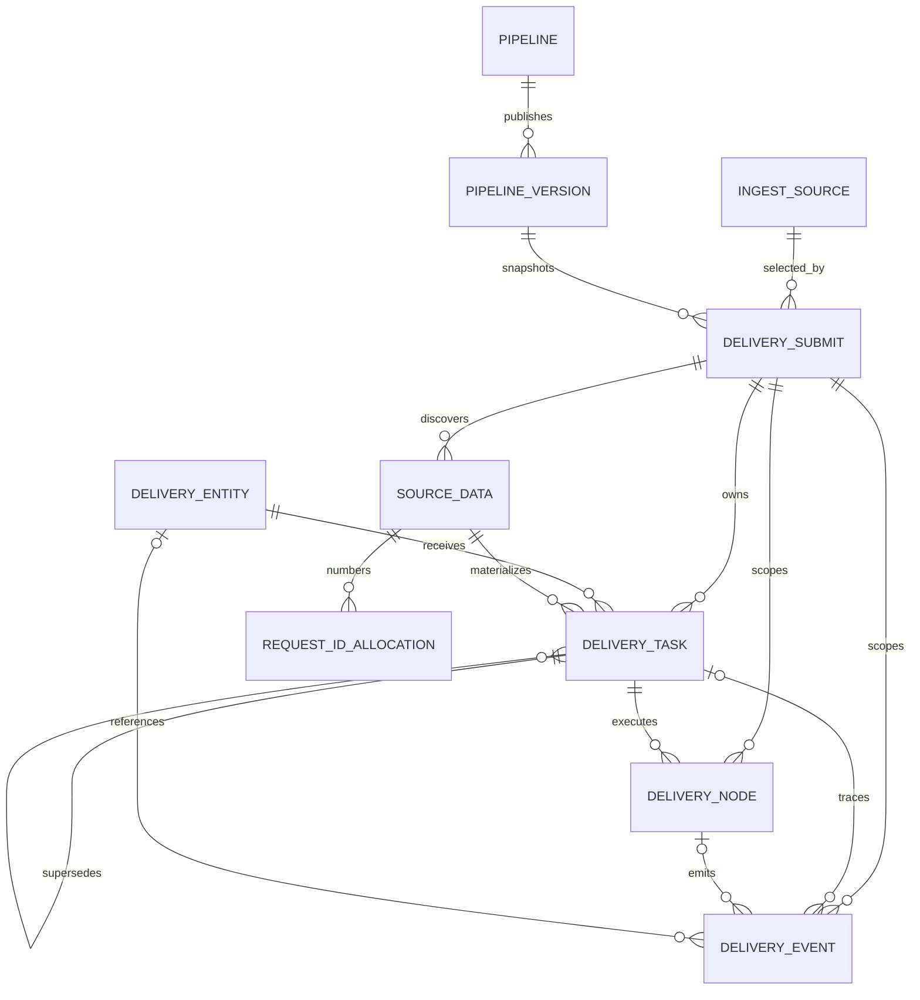

# Archive Delivery 实体目标升级版模型与数据字典

> 修订日期：2026-11-07
> 状态：当前唯一模型基线
> schema：`archive_delivery`
> 配套方案：`2026-11-06-archive-delivery-platform-upgrade-design.md`
> 数据策略：不兼容、不回填老数据；V14 在显式授权环境清空旧业务表并重建

## 1. 建模约定

1. 核心标识为 `delivery_id/data_id/delivery_entity_id/task_id/process_id`。`delivery_node.node_id` 是 Pipeline 字符串节点标识，不是尝试主键。
2. 所有表、列和枚举必须有数据库注释；时间使用 timestamptz，业务日期使用 date，ID 使用 bigint，扩展事实使用 jsonb。
3. 通用模型不出现地区、具体 Bucket、FTP 路径或实现专用列。节点定位使用通用 JSONB，阶段语义来自 PipelineVersion。
4. 配置类信息遵循“能集中就集中，方便查找和统一维护”：节点定义、规则和流程配置全部进入 pipeline_version，不拆平行配置表。
5. Secret 只由 Pipeline 节点配置受控维护，不进入实体、locator、artifacts、delivery_node、事件或普通 API。
6. `source_data` 是数据事实，`delivery_task` 是面向实体的执行原子，`delivery_node` 是节点尝试，`delivery_event` 是不可变事件。
7. JSONB 不替代提交、源数据、任务、实体和节点间的关系约束。

## 2. 核心 ER



核心不变量：

- task.delivery_id 必须等于 source_data.delivery_id；delivery_node.delivery_id 必须等于 task.delivery_id，由应用事务验证。
- task 直接引用启用实体；target_seq 在同一提交同一实体内从 1 分配且不超过 targetCount。
- 非 EXPIRED/CANCELLED 任务计入主单有效目标；跨日新 task 占用下一交付日对应实体配额，旧 EXPIRED 只保留历史，不与新 task 重复计数。
- task 用 data_id + artifact_seq 定位一个产物，文件、size/token/SHA 必须与 artifact 一致。
- 跨日保持 delivery_id/data_id/delivery_entity_id/target_seq/artifact_seq，旧任务 superseded_by_task_id 指向新 task_id；主单未全部成功前为 PARTIALLY_DELIVERED。
- 每个 delivery_node 只写当前节点通用 locator，不写 Secret 或其他节点私有字段。

## 3. 来源、实体与集中配置

### 3.1 ingest_source

| 字段 | 类型/约束 | 用途 |
|---|---|---|
| source_id | bigint identity PK | 来源 ID |
| oss_uri | varchar(1280) unique not null | 无 Secret、无签名参数的 OSS URI |
| availability_status | varchar(16) default AVAILABLE | AVAILABLE/UNAVAILABLE |
| channel_code | varchar(64) not null | 供应商或业务渠道 |
| oss_type | varchar(32) not null | 对象存储类型 |
| previous_refresh_bytes | bigint default 0 check >=0 | 上一次成功刷新字节数 |
| latest_refresh_bytes | bigint default 0 check >=0 | 最近成功刷新字节数 |

只保留七列；没有刷新历史或每日统计表。

### 3.2 delivery_entity

| 字段 | 类型/约束 | 用途 |
|---|---|---|
| delivery_entity_id | bigint identity PK | 实体 ID |
| vendor_code/entity_code | varchar(64)，联合唯一 | 厂商与厂商内实体编码 |
| entity_name | varchar(128) not null | 展示名称 |
| protocol | varchar(32) not null | 实体能力协议，不决定 DAG |
| account_name | varchar(128) not null | 业务账户，不是密码 |
| endpoint_locator | jsonb object default '{}' | host/port/rootPath 等非 Secret 定位 |
| enabled | boolean default true | 是否允许新提交引用 |
| created_at/updated_at | timestamptz not null | 创建和修改时间 |

endpoint_locator 禁止 password、privateKey、accessKeyId、accessKeySecret 和签名 URL。

### 3.3 pipeline / pipeline_version

`pipeline`：pipeline_id、pipeline_code unique、description、created_at。

`pipeline_version`：

| 字段 | 类型/约束 | 用途 |
|---|---|---|
| pipeline_version_id | bigint identity PK | 版本 ID |
| pipeline_id | bigint FK not null | 所属 Pipeline |
| version_no | int >0，与 pipeline_id 联合唯一 | 版本号 |
| status | varchar(16) | DRAFT/PUBLISHED/ARCHIVED |
| definition | jsonb object not null | 全部流程配置和规则 |
| definition_sha256 | varchar(64) 小写 SHA | 快照完整性 |
| created_by | varchar(64) | 创建者 |
| published_at | timestamptz null | 发布时间 |
| created_at | timestamptz not null | 创建时间 |

definition 顶层结构：

```json
{
  "pipelineCode": "archive-delivery",
  "version": 1,
  "nodeDefinitions": {
    "oss.download": {
      "enabled": true,
      "configSchema": {"type": "object"},
      "inputContract": {"type": "object"},
      "outputContract": {"type": "object"}
    }
  },
  "ruleSets": {
    "fix-archive-legacy-v1": {
      "version": 1,
      "status": "PUBLISHED",
      "definition": {"schemaVersion": 1}
    }
  },
  "config": {
    "businessTimezone": "Asia/Shanghai",
    "deliveryCutoffTime": "18:00:00",
    "rolloverStartNode": "targetUpload",
    "selection": {"orderBy": "key", "limit": 3, "duplicatePolicy": "FILTER_WITH_REASON"},
    "assignment": {"strategySource": "SUBMIT_TARGETS"},
    "concurrency": {"maxRunningTasks": 3},
    "retry": {"maxAttempts": 5}
  },
  "nodes": []
}
```

只有 PUBLISHED 可提交，发布后 definition 不可改。Secret 只写不读并脱敏返回。数据库 CHECK 要保障 nodeDefinitions/ruleSets 为 object，应用发布校验节点类型、规则引用、DAG 和节点 Schema。

## 4. 交付提交与源数据

### 4.1 delivery_submit

| 字段 | 类型/约束 | 用途 |
|---|---|---|
| delivery_id | bigint identity PK | 跨日稳定交付 ID |
| delivery_batch | varchar(128) not null | 用户批次，与 source_id 联合唯一 |
| source_id | bigint FK not null | 来源 |
| pipeline_version_id | bigint FK not null | 不可变版本 |
| idempotency_key | varchar(128) unique not null | 全局幂等键 |
| delivery_date | date not null | 首个交付日 |
| cutoff_at | timestamptz not null | 首批截止时间 |
| submitted_at | timestamptz not null | 接受时间 |
| target_strategy | jsonb object not null | targets 请求快照 |
| status | varchar(40) default SUBMITTED | 聚合状态 |
| discovery_completed_at | timestamptz null | 发现和规划完成时间 |
| completed_at | timestamptz null | 交付或取消终态时间 |
| created_at/updated_at | timestamptz not null | 创建和投影更新时间 |

索引：(status,updated_at,delivery_id)、(pipeline_version_id,delivery_id)。没有组策略、组表或来源绑定表。

target_strategy 严格契约：

```json
{
  "schemaVersion": 1,
  "targets": [
    {"targetCount": 1, "deliveryEntityId": 101},
    {"targetCount": 1, "deliveryEntityId": 102},
    {"targetCount": 1, "deliveryEntityId": 103}
  ]
}
```

targets 非空，实体在提交内不重复，targetCount 为正整数；快照不随任务状态回写。

### 4.2 source_data

| 字段 | 类型/约束 | 用途 |
|---|---|---|
| data_id | bigint identity PK | 源数据 ID |
| delivery_id | bigint FK not null | 所属提交 |
| original_request_id/new_request_id | varchar(256) null | 原始/repair 后请求编号 |
| request_namespace | varchar(128) default '' | 编号命名空间 |
| original_locator | jsonb object default '{}' | 原始定位 |
| output_locator | jsonb object default '{}' | repair 后包内定位 |
| qualification | varchar(32) default PENDING | PENDING/QUALIFIED/QUALIFIED_WITH_SKIPS/FILTERED/UNQUALIFIED |
| filter_rule_code/filter_reason | varchar null | FILTERED 时必填 |
| affected_count | bigint >=0 | 影响条目数 |
| rule_version | varchar(128) null | repair 规则版本 |
| size_bytes/token_count | bigint >=0 | 主产物大小与 token |
| sha256 | varchar(64) null | 主产物 SHA |
| artifacts | jsonb array default '[]' | 严格七字段产物数组 |

约束：

```text
UNIQUE(request_namespace,new_request_id)
  WHERE new_request_id IS NOT NULL AND qualification<>'FILTERED'
UNIQUE(delivery_id,(original_locator->>'sourceUri'),(original_locator->>'sourceVersion'))
  WHERE qualification<>'FILTERED'
INDEX(delivery_id,qualification,data_id)
INDEX(delivery_id,sha256) WHERE sha256 IS NOT NULL
CHECK(qualification<>'FILTERED' OR filter_rule_code/filter_reason 均非空)
```

original_locator 白名单：schemaVersion/sourceUri/sourceVersion/memberPath/responsePaths。output_locator 白名单：schemaVersion/memberPath/manifestPath，不保存交付 OSS/FTP URI。

artifacts 每项严格七字段：

```json
{
  "artifactSeq": 1,
  "originalFileName": "batch_00001.tar.gz",
  "newFileName": "batch_00001.tar.gz",
  "sizeBytes": 10240,
  "sha256": "64-lowercase-hex-characters",
  "token": 2048,
  "file_mapping": {"req_0001": "req_0003"}
}
```

artifactSeq/newFileName 数组内唯一；文件名不得含路径分隔符或 `..`；数值非负；file_mapping 为 object。数据库触发器拒绝额外字段。

## 5. 交付任务与节点

### 5.1 delivery_task

| 字段组 | 字段 | 类型/约束与用途 |
|---|---|---|
| 血缘目标 | task_id | bigint identity PK，跨日生成新值 |
|  | delivery_id/data_id | bigint FK not null |
|  | delivery_entity_id | bigint FK not null，直接交付实体 |
|  | target_seq | int >0，同一提交实体内目标序号 |
|  | artifact_seq | int >0，产物序号 |
| 日期 | delivery_date/cutoff_at | date/timestamptz not null |
| 文件 | original_file_name/new_file_name | varchar(512) not null |
|  | size_bytes/token_count | bigint >=0 |
|  | sha256 | varchar(64) null，小写 SHA |
| 执行 | current_node_id | varchar(64) not null |
|  | execution_status | READY/RUNNING/WAITING/RETRY_WAIT/BLOCKED/SUCCEEDED/EXPIRED/CANCELLED |
| 租约 | lease_owner/lease_until | Worker 与租约截止，可空 |
|  | fence | bigint default 0，claim 递增 |
| 重试 | retry_count | int >=0 |
|  | next_retry_at/last_error_code | 可空 |
| 跨日 | superseded_by_task_id | bigint FK unique null |
|  | invalidated_at/invalidation_reason | EXPIRED 时记录 |
| 时间 | completed_at/created_at/updated_at | 完成、创建和更新时间 |

约束与索引：

```text
UNIQUE(delivery_id,delivery_entity_id,delivery_date,new_file_name)
UNIQUE(delivery_id,delivery_entity_id,data_id,artifact_seq)
  WHERE execution_status NOT IN('EXPIRED','CANCELLED')
UNIQUE(delivery_id,delivery_entity_id,target_seq)
  WHERE execution_status NOT IN('EXPIRED','CANCELLED')
UNIQUE(superseded_by_task_id)
CHECK((execution_status='EXPIRED')=(invalidated_at IS NOT NULL))
INDEX(delivery_id,execution_status,delivery_date,task_id)
INDEX(execution_status,next_retry_at,delivery_date,task_id)
INDEX(cutoff_at,task_id) WHERE 非成功/超期/取消
INDEX(delivery_entity_id,execution_status,task_id)
```

没有 delivery_group_id、group_code、assigned_count 或组状态。目标 assignedCount/completedCount/status 由查询派生。

### 5.2 delivery_node

| 字段 | 类型/约束 | 用途 |
|---|---|---|
| process_id | bigint identity PK | 一次节点尝试 ID |
| delivery_id/task_id | bigint FK not null | 完整任务血缘 |
| original_file_name/new_file_name | varchar(512) not null | 文件名快照 |
| node_id/node_type/stage_code | varchar not null | DAG 节点、类型和阶段快照 |
| attempt | int >0 | 同 task/node 内递增 |
| fence | bigint not null | claim 执行纪元 |
| status | varchar(16) | RUNNING/SUCCEEDED/WAITING/FAILED/CANCELLED |
| worker_instance_id | varchar(128) null | Worker 实例 |
| input_locator/output_locator | jsonb object default '{}' | 通用输入输出定位 |
| error_code/error_detail | 可空 | 脱敏错误 |
| started_at/heartbeat_at/finished_at | timestamptz | 开始、心跳和结束时间 |

约束：UNIQUE(task_id,node_id,attempt)；索引(delivery_id,task_id,started_at,process_id) 和 RUNNING 心跳索引。没有 implementation、Manifest、PID、progress 或多输出关联表。

output_locator 示例：

```json
{
  "schemaVersion": 1,
  "nodeId": "targetUpload",
  "uri": "oss://target-bucket/archive-delivery/1/entity-101/2026-11-07/batch_00001.tar.gz",
  "sizeBytes": 10240,
  "sha256": "64-lowercase-hex-characters",
  "verifiedAt": "2026-11-07T10:00:00Z"
}
```

nodeId 必须等于本行 node_id。最终 FTP 节点额外保存 downloadPath 和实际下载 size/SHA。URI 不得包含 Secret 或签名参数。

## 6. 请求编号与事件

`request_id_sequence`：request_namespace PK、next_value >=0、updated_at。通过行锁分配，失败空洞不回收。

`request_id_allocation`：allocation_id、request_namespace、data_id FK、request_key、start_value、count_value >0、created_at；UNIQUE(request_namespace,data_id,request_key) 和 UNIQUE(request_namespace,start_value)。

`delivery_event`：

| 字段 | 类型/约束 | 用途 |
|---|---|---|
| event_id | bigint identity PK | 事件 ID |
| delivery_id | bigint FK not null | 所属交付 |
| task_id/process_id | bigint FK null | 相关任务和 delivery_node 尝试 |
| delivery_entity_id/data_id | bigint FK null | 相关实体和源数据 |
| event_type | varchar(64) not null | 稳定机器码 |
| severity | INFO/WARN/ERROR | 级别 |
| reason_code/message | 可空 | 脱敏原因 |
| payload | jsonb object default '{}' | 白名单结构化事实 |
| operator_id | varchar(64) null | 人工操作者 |
| occurred_at | timestamptz not null | 发生时间 |
| dedup_key | varchar(256)，与 delivery_id 联合唯一 | 幂等去重 |

事件只 INSERT，数据库触发器拒绝 UPDATE/DELETE。payload 可含 dataId/taskId/processId/deliveryEntityId/targetSeq、safe URI、SHA、日期和原因，禁止 Secret、私钥、完整请求响应和 Shell。

## 7. 状态与跨日

delivery_submit.status：

```text
SUBMITTED / DISCOVERING / PLANNING / PROCESSING / WAITING / RETRYING /
BLOCKED / PARTIALLY_DELIVERED / DELIVERED / COMPLETED_WITH_CANCELLATIONS / CANCELLED
```

DELIVERED 要求 discovery 完成、active 等于 targetCount 总和且全部 SUCCEEDED。active 只统计非 EXPIRED/CANCELLED 任务。存在 EXPIRED 血缘且尚未全部成功时为 PARTIALLY_DELIVERED；该状态不是终态，completed_at 保持 NULL，次日继续期间不改变，全部成功后 DELIVERED。

跨日字段关系：

```text
旧任务：EXPIRED，invalidated_at 非空，invalidation_reason=CUTOFF_EXCEEDED，
        superseded_by_task_id=新 task_id
新任务：delivery_date=指定下一交付日，cutoff_at=该日 Pipeline 截止，
        current_node_id=rolloverStartNode，retry_count=0
不变：  delivery_id/data_id/delivery_entity_id/target_seq/artifact_seq
配额：  新 task_id 占下一交付日对应实体配额，旧 EXPIRED 不与新任务重复计数
```

人工 rollover 必须输入 expectedDeliveryDate、deliveryDate、reason，且新日期晚于原日期。同一旧任务最多一个新任务，同一新任务最多被一个旧任务指向，禁止环。V15 增加 PARTIALLY_DELIVERED 状态 CHECK 和列注释，不改变 V14 清空重建契约。

## 8. 最终删除对象与 V14 契约

升级后不得存在：

```text
delivery_group
delivery_pipeline_submit
delivery_task_process
node_definition
rule_set
source_pipeline_binding
delivery_node_task_output
ingest_source_daily_stat
ingest_source_refresh
operation_audit
source_package / source_request / output_package / delivery_node_task
production_group / production_line
```

V14 执行要求：

1. 停止 server/Worker，仅在明确放弃老数据的环境设置 `archive_delivery.upgrade_authorized=2026-11-07`。
2. 清空 schema 内旧业务表，身份序列重新开始；不读取、映射或保留旧交付数据。
3. 创建本文表、外键、CHECK、索引、触发器和全部 COMMENT ON。
4. 不创建兼容视图、legacy task 或旧 ID 映射，不做迁移对账。
5. 验收查询第 8 章对象不存在，当前核心表存在，全表全列注释覆盖率 100%。

## 9. 本地与外部定位

源下载、repair、OSS 回验和 FTP 下载路径属于受控运行事实，保存在 delivery_node 通用 locator；路径必须限制在 Worker 工作根目录。外部对象键使用：

```text
{configuredPrefix}/{deliveryId}/entity-{deliveryEntityId}/{deliveryDate}/{newFileName}
```

FTP 相对路径使用：

```text
{deliveryId}/{deliveryDate}/entity-{deliveryEntityId}/{newFileName}
```

同 URI 同 SHA 幂等成功，不同 SHA 阻断；不得清理历史目录或覆盖其他任务文件。
