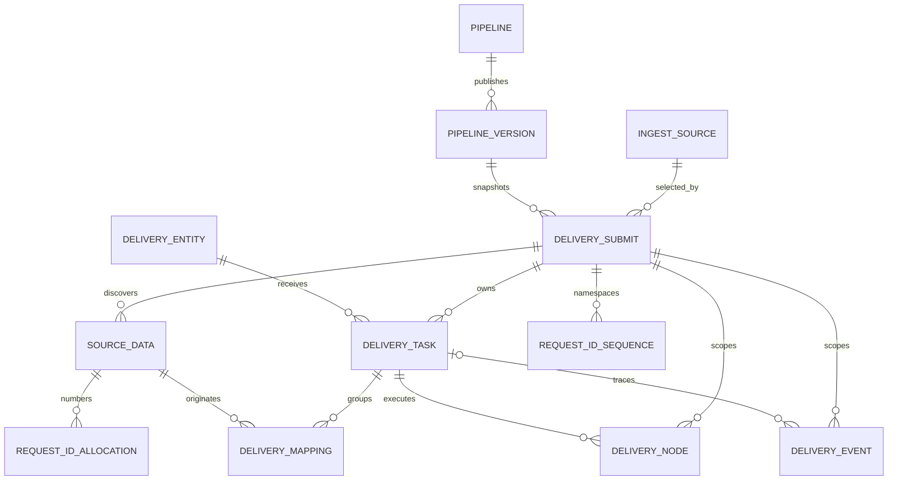

# Archive Delivery 实体目标升级版模型与数据字典

> 修订日期：2026-11-08
> 状态：当前唯一模型基线
> schema：`archive_delivery`
> 配套方案：`2026-11-06-archive-delivery-platform-upgrade-design.md`
> 数据策略：不兼容、不回填老数据；V14 清空重建，V15/V16/V17 为当前增量

## 1. 建模约定

1. 核心血缘为 `delivery_submit → source_data → delivery_mapping → delivery_task → delivery_node`；`process_id` 是节点尝试主键，字符串 `node_id` 是 DAG 节点标识。
2. 外部提交只使用 `ossUri/pipelineCode/deliveryDate/deliveryBatch/cutoffAt` 和 `vendorCode+entityCode` targets，数据库 ID 仅是内部关系事实。`delivery_batch` 全局唯一，同时是幂等键和请求编号命名空间。
3. 所有表、列和枚举必须有 COMMENT ON；时间使用 timestamptz，业务日期使用 date，扩展事实使用 jsonb。新增模型表必须默认同时带 created_at/updated_at。
4. 节点定义、规则、DAG、选择、分配、重试、跨日、并发和 Secret 集中在 `pipeline_version.definition`，不建立平行配置表。
5. Secret 不进入实体、locator、artifacts、metadata_ids、事件、日志或普通 API。
6. JSONB 不替代关系约束；任务的完整来源集合只由 `delivery_mapping` 定义。

## 2. 核心 ER 与不变量



- mapping 的 task/delivery 与 data/delivery 复合外键保证任务和来源属于同一提交。
- 一个任务的 `source_seq` 从 1 连续分配，`(task_id,data_id)` 唯一；跨日新 taskId 复制完整映射。
- `delivery_task` 保存 entity_code，不保存 data_id、target_seq、artifact_seq、original_file_name、sha256、superseded_by_task_id、invalidated_at、invalidation_reason 或单数 artifact。
- 跨日新旧 taskId、日期和原因由 `delivery_event` 的 TASK_EXPIRED/TASK_REGENERATED payload 保存；旧任务 EXPIRED，新任务占下一日目标配额。
- 来源原始 original_file_name/size/SHA/artifact 不被合并产物覆盖；任务的每个 sourceArtifact 必须等于对应 source_data.artifact。

## 3. 来源、实体与集中配置

### 3.1 ingest_source

| 字段 | 类型/约束 | 用途 |
|---|---|---|
| source_id | bigint identity PK | 内部来源 ID，不由提交 API 传入 |
| oss_uri | varchar(1280) unique not null | 无 Secret、无签名参数的原始 OSS URI |
| availability_status | varchar(16) | AVAILABLE/UNAVAILABLE |
| channel_code/oss_type | varchar not null | 渠道和对象存储类型；URI 首次提交时自动登记 |
| previous_refresh_bytes/latest_refresh_bytes | bigint >=0 | 最近两次成功发现字节数 |

### 3.2 delivery_entity

| 字段 | 类型/约束 | 用途 |
|---|---|---|
| delivery_entity_id | bigint identity PK | 内部实体 ID |
| vendor_code | varchar(64) not null | 与 entity_code 联合唯一，同厂商多个实体整体分配 |
| entity_code | varchar(64) not null | 与 vendor_code 联合唯一，复合提交和 repair 使用 |
| entity_name | varchar(128) not null | 展示名称 |
| protocol/account_name | varchar not null | 交付协议与业务账户，不是密码 |
| worker_group | varchar(32) not null | 单服务器执行组，新任务保存快照 |
| endpoint_locator | jsonb object | host/port/rootPath 等非 Secret 定位 |
| enabled | boolean | 是否允许新提交引用 |
| created_at/updated_at | timestamptz | 创建与修改时间 |

### 3.3 pipeline / pipeline_version

`pipeline` 保存内部 pipeline_id、唯一 pipeline_code、description、created_at。`pipeline_version` 保存内部版本 ID、pipeline_id、version_no、状态、definition、definition_sha256、created_by、published_at、created_at。

`pipeline_code` 提交时选择 version_no 最大的 PUBLISHED 版本，提交后固化 pipeline_version_id。definition 顶层只有 `pipelineCode/version/nodeDefinitions/ruleSets/config/nodes` 契约；PUBLISHED 不可改。提交显式携带 cutoffAt，服务端只校验其在未来，不再从 Pipeline 推导。

## 4. 提交、来源与请求编号

### 4.1 delivery_submit

| 字段 | 类型/约束 | 用途 |
|---|---|---|
| delivery_id | bigint identity PK | 跨日稳定交付 ID |
| delivery_batch | varchar(128) unique not null | 全局幂等键和 request_namespace |
| source_id | bigint FK not null | 由 ossUri 解析的内部来源 |
| pipeline_version_id | bigint FK not null | 由 pipelineCode 选择的不可变版本 |
| delivery_date/cutoff_at | date/timestamptz not null | 首个交付日与提交显式截止时间 |
| submitted_at | timestamptz not null | 接受时间 |
| target_strategy | jsonb object not null | 不可变 vendorCode/entityCode/targetCount 快照 |
| status | varchar(40) | 聚合状态，含 PAUSED |
| discovery_completed_at/completed_at | timestamptz null | 规划完成和终态时间 |
| created_at/updated_at | timestamptz | 创建和投影时间 |

```json
{
  "schemaVersion": 1,
  "targets": [
    {"targetCount": 1, "vendorCode": "alibaba", "entityCode": "jun"},
    {"targetCount": 1, "vendorCode": "alibaba", "entityCode": "jun2"}
  ]
}
```

相同 deliveryBatch 且 ossUri、pipelineCode、deliveryDate、targets 完全一致时返回原 deliveryId；不同参数返回 409。主单 PAUSED 时，相同请求把所有 PAUSED 任务从各自 current_node_id 恢复为 READY，不重复发现、建单或分配号段。

### 4.2 source_data

保留 data_id、delivery_id、original_file_name、request_namespace、original/output_locator、qualification、过滤原因、affected_count、rule_version、原始 size_bytes/token_count/sha256、单个 artifact、created_at/updated_at；不保存 original_request_id、new_request_id 或 artifacts 数组。repair 后同任务来源的 request_namespace 统一为 deliveryBatch，updated_at 由触发器维护。

original_locator 白名单为 schemaVersion/sourceUri/sourceVersion/cachePath/memberPath/responsePaths；cachePath 是 URI+版本确定的同机共享源包缓存，跨 delivery 和其他厂商分配复用时不重复 OSS GET，其他执行组缓存缺失时回退 OSS。output_locator 白名单为 schemaVersion/memberPath/manifestPath。artifact 是严格七字段对象，并与 original_file_name/size/token/SHA 完全一致：

```json
{
  "artifactSeq": 1,
  "originalFileName": "batch_00001.tar.gz",
  "newFileName": "batch_00001.tar.gz",
  "sizeBytes": 10240,
  "sha256": "64-lowercase-hex-characters",
  "token": 2048,
  "file_mapping": {}
}
```

### 4.3 request_id_sequence / request_id_allocation

两表 request_namespace 均外键引用 `delivery_submit.delivery_batch`。sequence 通过行锁分配不重叠号段；allocation 保存 allocation_id、request_namespace、data_id、request_key、start_value、count_value、created_at。repair 重试按命名空间、首来源 dataId 和 requestKey 复用原号段，失败空洞不回收。全局唯一 deliveryBatch 防止不同提交共用请求号段。

## 5. 交付任务、映射与节点

### 5.1 delivery_mapping

| 字段 | 类型/约束 | 用途 |
|---|---|---|
| task_id/delivery_id | bigint 复合 FK | 所属任务和提交 |
| data_id | bigint 复合 FK | 同提交 source_data |
| source_seq | int >0 | 下载、合并顺序 |
| created_at/updated_at | timestamptz | 映射创建和最近更新时间，默认当前时间 |

主键 `(task_id,source_seq)`，`UNIQUE(task_id,data_id)`；索引覆盖 data_id 和 `(delivery_id,task_id,source_seq)`。

### 5.2 delivery_task

| 字段组 | 字段 | 类型/约束与用途 |
|---|---|---|
| 血缘 | task_id/delivery_id/delivery_entity_id/entity_code | bigint PK/FK 与实体编码快照 |
| 执行域 | worker_group | varchar(32)，创建和跨日固化 |
| 日期 | delivery_date/cutoff_at | 当前交付日和截止 |
| 文件 | new_file_name | varchar(512)，delivery 内连续序号；有效任务文件名全局唯一 |
| 汇总 | size_bytes/token_count | bigint >=0，repair 前为来源合计，修复后严格等于交付包值 |
| 产物 | artifacts | jsonb array not null default []，逐来源产物对 |
| 元数据 | metadata_ids | jsonb array not null default []，修复后 requestId 列表 |
| 执行 | current_node_id/execution_status | 当前 DAG 节点和状态 |
| 租约 | lease_owner/lease_until/fence | Worker 租约和执行纪元 |
| 重试 | retry_count/next_retry_at/last_error_code | 有界重试事实 |
| 时间 | completed_at/created_at/updated_at | 完成、创建和更新时间 |

任务状态：`READY/RUNNING/WAITING/RETRY_WAIT/BLOCKED/PAUSED/SUCCEEDED/EXPIRED/CANCELLED`。PAUSED 只在节点边界设置，不被 claim。`uk_task_active_delivery_file_name(delivery_id,new_file_name)` 只排除 EXPIRED/CANCELLED，因此跨日新 taskId 可复用原包名，不同实体有效任务不能重名。

artifacts 每项严格三字段：

```json
{
  "dataId": 101,
  "sourceArtifact": {
    "artifactSeq": 1,
    "originalFileName": "source-01.tar.gz",
    "newFileName": "source-01.tar.gz",
    "sizeBytes": 1024,
    "sha256": "source-sha256",
    "token": 1024,
    "file_mapping": {}
  },
  "deliveryArtifact": {
    "artifactSeq": 1,
    "originalFileName": "source-01.tar.gz",
    "newFileName": "batch_00001.tar.gz",
    "sizeBytes": 2048,
    "sha256": "delivery-sha256",
    "token": 2048,
    "file_mapping": {"old-request-dir": "new-request-id"}
  }
}
```

repair 前 deliveryArtifact 为 JSON null，任务 size/token 等于来源原始值合计；repair 后每个来源对保存同一合并包的 size/token/SHA/newFileName，任务 size/token 与其一致。sourceArtifact 必须逐字段等于同 delivery 下 source_data.artifact。file_mapping 只包含该 dataId 对应来源的请求，键是真实 originalPath，值是新 requestId；跨源同名目录分别保存在各自来源对中，不写人工成员键。dataId 在数组内唯一，两个 artifact 均严格七字段。metadata_ids 是字符串数组，每项为修复后请求目录及其 `metadata.json` 的 requestId，数组内唯一，并与所有来源 file_mapping 的 requestId 全集完全一致。

### 5.3 delivery_node

保留 process_id、delivery_id/task_id、执行时 original/new_file_name 快照、node_id/node_type/stage_code、attempt、fence、status、worker_instance_id、通用 input/output_locator、脱敏错误和时间。任务删除 original_file_name 不影响节点历史快照；新节点从首来源 sourceArtifact 取得原始文件名。repair locator 同时保存 entityCode。

最终 OSS/FTP locator 保存安全 URI、下载路径、size/SHA、verifiedAt；不保存 Secret 或签名参数。

## 6. 事件与状态

delivery_event 只 INSERT，保存 delivery_id、可选 task/process/entity/data 血缘、event_type、severity、reason/message、白名单 payload、operator、occurred_at、dedup_key。

提交状态：

```text
SUBMITTED / DISCOVERING / PLANNING / PROCESSING / WAITING / RETRYING /
BLOCKED / PAUSED / PARTIALLY_DELIVERED / DELIVERED /
COMPLETED_WITH_CANCELLATIONS / CANCELLED
```

DELIVERED 要求 discovery 完成、有效任务数等于 targetCount 总和且全部 SUCCEEDED。PAUSED 优先于其他非终态投影。存在 EXPIRED 血缘且未全部成功时为 PARTIALLY_DELIVERED，completed_at 保持 NULL。

跨日事件 payload：

```json
{
  "taskId": 10,
  "oldTaskId": 10,
  "newTaskId": 11,
  "oldDeliveryDate": "2026-11-08",
  "newDeliveryDate": "2026-11-09"
}
```

新任务复制 delivery_id、entity/entity_code、worker_group、new_file_name、artifacts、metadata_ids 和完整 delivery_mapping，从 rolloverStartNode 开始，retryCount 清零。

## 7. V17 最终对象与安全约束

V17 直接形成上述模型，不保留 source_data.original/new_request_id、artifacts 数组、delivery_task_source、旧任务字段、idempotency_key、兼容视图或旧 ID 映射。所有新表、列、枚举和触发器有注释；数据库触发器强制 source_data 原始事实与 artifact 一致、任务 sourceArtifact 与 source_data.artifact 一致，以及合并包 size/token、逐来源映射和 metadata_ids 一致。

源文件、merge 工作目录、repair 包和 FTP 下载文件均位于 Worker 受控持久目录。非模板 OSS 路径包含 `deliveryBatch/deliveryId/entity/date`，本地 FTP 模板包含 deliveryBatch；生产使用 `{providerCode}/{deliveryDate}-{deliveryBatch}-{providerCode}` 模板。所有路径都隔离不同批次；同 URI 同 SHA 幂等，不同 SHA 阻断且不覆盖历史。
