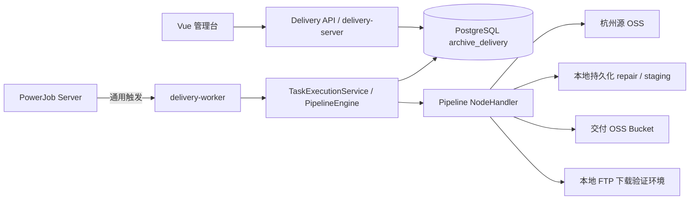
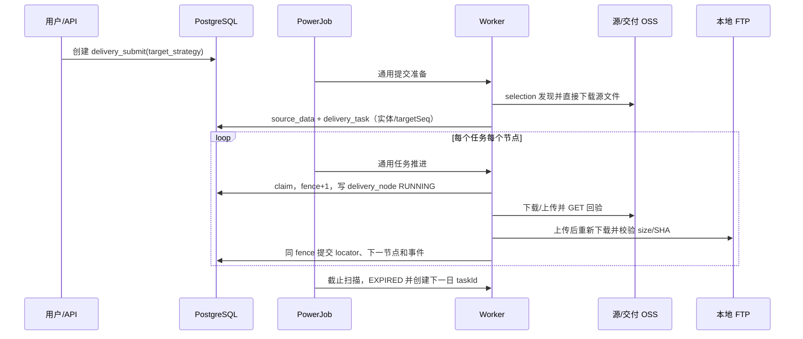

# Archive Delivery Platform 实体目标升级版方案设计

> 修订日期：2026-11-07
> 状态：当前唯一实施基线
> 配套模型：`2026-11-06-archive-delivery-model-upgrade-design.md`
> 数据策略：不兼容、不回填老数据；V14 在显式授权环境清空旧业务表并重建

## 1. 目标与决策

本平台是由 Pipeline 定义的通用归档数据交付系统。PostgreSQL 是业务事实源，PowerJob 只触发通用执行入口，Worker 按提交绑定的不可变 PipelineVersion 推进节点。

本次升级确定：

1. 核心血缘为 `delivery_submit(delivery_id) → source_data(delivery_id) → delivery_task(task_id) → delivery_node(task_id,process_id)`。
2. 交付提交直接表达“交付到哪些实体、每个实体多少产物”，不再建立交付组领域、组编码、组状态或组配额表。
3. `delivery_task` 直接保存 `delivery_entity_id + target_seq`。多个交付实体只是多个 `targets`，不引入中间组对象。
4. `delivery_pipeline_submit` 更名为 `delivery_submit`，`delivery_task_process` 更名为 `delivery_node`。`process_id` 仍是一次节点尝试主键，字符串 `node_id` 仍是 Pipeline DAG 节点标识。
5. 节点元数据、规则、DAG、选择、目标分配、重试、跨日、并发和节点 Secret 统一汇集在 `pipeline_version.definition`。不保留 `node_definition`、`rule_set`、`source_pipeline_binding`。
6. 核心真实链路为：杭州源 OSS 密钥直下载并保留本地文件 → 本地 repair → qualify → 三个交付实体各一个任务 → 上传另一 OSS Bucket → 本地 FTP 上传并重新下载验证 size/SHA → DELIVERED。
7. 不使用 SSH 跳板机、CRR、新加坡中转、远端 SSH 发布或旧回执链。新协议只新增 Pipeline 节点。
8. 超过 `cutoff_at` 未完成的任务 EXPIRED，并生成下一交付日的新 `task_id`；`delivery_id/data_id/delivery_entity_id/target_seq/artifact_seq` 保持不变。
9. 配置类信息以集中、可查找、统一维护为原则。只有具有独立生命周期和并发事实的 `pipeline` 与 `pipeline_version` 保留，不为节点、规则或来源绑定拆分平行配置表。

## 2. 范围与边界

本期包含提交幂等、实体目标快照、OSS 源发现与重复过滤、repair/qualify、任务形成、节点尝试、动态看板、retry/resume/rollover，以及真实 OSS/FTP 外部核验。

不包含老 API 或老数据适配、双写、回填、迁移对账、跳板机、独立操作审计、资产刷新历史、每日统计、通知、完整 RBAC 和可视化 DAG 编辑器。

## 3. 核心对象

| 对象 | 职责 | 关键边界 |
|---|---|---|
| `delivery_submit` | 一次交付的稳定身份、来源、PipelineVersion 和目标快照 | `target_strategy` 是不可变请求事实；状态由任务投影 |
| `source_data` | 源定位、过滤、repair、请求映射和产物事实 | 不保存 Worker 租约或节点 Secret |
| `delivery_entity` | 厂商、协议、账户和非 Secret 目标定位 | 不保存密码、AK/SK、私钥 |
| `delivery_task` | 一个 artifact 面向一个实体的执行原子 | 直接保存实体与目标内序号；跨日新 taskId |
| `delivery_node` | 某任务某节点的一次执行尝试 | 保存通用 locator、错误和 fence，不保存 Manifest/PID/progress |
| `delivery_event` | 过滤、人工原因、跨日和外部核验的不可变事件 | 只 INSERT，不保存 Secret |
| `pipeline_version` | 集中保存全部流程配置和规则 | PUBLISHED 不可改；修改创建新版本 |

## 4. 总体架构



| 组件 | 负责 | 不负责 |
|---|---|---|
| delivery-server | 提交、查询、Pipeline/实体管理、retry/resume/rollover | 直接执行 repair 或外部节点 |
| PowerJob | 提交准备、任务推进和截止扫描触发 | 判断交付成功或定义 DAG |
| delivery-worker | 有界 claim、lease/fence、NodeHandler 调用 | 写死固定交付链 |
| PipelineEngine | 解析同版 DAG、选择处理器、校验后继 | 增加隐式节点或另一套状态 |
| Python | 数据面安全 repair、FTP 下载与 SHA | 直接写 PG 或决定任务状态 |
| PostgreSQL | 提交、源数据、任务、节点、事件和并发事实 | 在普通投影暴露 Secret |

PowerJob 实例成功不等于交付成功。只有 Pipeline 最终节点成功且外部 size/SHA 核验完成，任务才 SUCCEEDED；目标数量满足且最新任务全部成功，提交才 DELIVERED。

## 5. 集中式 PipelineVersion

`definition` 顶层契约：

- `nodeDefinitions`：以 nodeType 为键，保存 enabled、configSchema、inputContract、outputContract。
- `ruleSets`：以规则编码为键，保存 version、status、definition；repair 节点只能引用同版规则。
- `nodes`：DAG 节点 id/type/stageCode/displayName/next/config。
- `config.selection`：源排序、数量、重复过滤。
- `config.assignment`：当前固定为 `SUBMIT_TARGETS`，只声明如何读取提交目标，不创建组节点。
- `config.rollover` 相关值：businessTimezone、deliveryCutoffTime、rolloverStartNode。
- `config.retry/concurrency`：有界重试和执行并发。

核心 DAG 为 `sourceDownload → repair → qualify → targetUpload → ftpDownloadVerify`。该顺序只是当前发布版本的内容，不是 Java 固有流程。

```yaml
pipelineCode: archive-delivery
version: 1
nodeDefinitions:
  oss.download: {enabled: true, configSchema: {}, inputContract: {}, outputContract: {}}
  python.repair: {enabled: true, configSchema: {}, inputContract: {}, outputContract: {}}
  manifest.qualify: {enabled: true, configSchema: {}, inputContract: {}, outputContract: {}}
  oss.upload: {enabled: true, configSchema: {}, inputContract: {}, outputContract: {}}
  ftp.download-verify: {enabled: true, configSchema: {}, inputContract: {}, outputContract: {}}
ruleSets:
  fix-archive-legacy-v1: {version: 1, status: PUBLISHED, definition: {schemaVersion: 1}}
config:
  businessTimezone: Asia/Shanghai
  deliveryCutoffTime: "18:00:00"
  rolloverStartNode: targetUpload
  selection: {orderBy: key, limit: 3, duplicatePolicy: FILTER_WITH_REASON}
  assignment: {strategySource: SUBMIT_TARGETS}
  concurrency: {maxRunningTasks: 3}
nodes:
  - {id: sourceDownload, type: oss.download, next: repair, config: "源 OSS 节点受控配置"}
  - {id: repair, type: python.repair, next: qualify, config: {ruleSet: fix-archive-legacy-v1}}
  - {id: qualify, type: manifest.qualify, next: targetUpload, config: {}}
  - {id: targetUpload, type: oss.upload, next: ftpDownloadVerify, config: "交付 OSS 节点受控配置"}
  - {id: ftpDownloadVerify, type: ftp.download-verify, next: null, config: {deliveryEntityFrom: TASK, ftpCredential: "账户密码受控映射"}}
```

发布时校验节点类型已启用、规则引用同版存在、DAG 唯一入口/无环/无不可达节点、Secret 非掩码或占位符，以及 OSS/FTP 安全约束。

## 6. 提交与 API

```text
POST /api/v1/deliveries
GET  /api/v1/deliveries/{deliveryId}
POST /api/v1/deliveries/{deliveryId}/resume
POST /api/v1/deliveries/{deliveryId}/rollover
GET  /api/v1/deliveries/{deliveryId}/tasks
POST /api/v1/tasks/{taskId}/retry
GET  /api/v1/tasks/{taskId}/timeline
GET  /api/v1/dashboard/targets?deliveryId={deliveryId}
```

提交请求：

```json
{
  "sourceId": 1,
  "pipelineVersionId": 7,
  "deliveryDate": "2026-11-07",
  "cutoffAt": "2026-11-07T18:00:00+08:00",
  "deliveryBatch": "BATCH-20261107-001",
  "idempotencyKey": "submit-20261107-001",
  "targets": [
    {"targetCount": 1, "deliveryEntityId": 101},
    {"targetCount": 1, "deliveryEntityId": 102},
    {"targetCount": 1, "deliveryEntityId": 103}
  ]
}
```

服务端要求来源可用、版本已发布、实体启用且协议受当前 Pipeline 支持；目标实体在提交内不重复，targetCount 为正整数，selection.limit 等于 targetCount 总和。未知字段由 Jackson 拒绝。幂等键相同且规范化请求一致时返回原 deliveryId，不同请求返回 409。

提交只写 `delivery_submit`。准备阶段按 targets 数组顺序和 targetCount 分配源产物，在任务写 `delivery_entity_id` 与从 1 开始的 `target_seq`。实体目标的数量、分配数、完成数和展示状态均从提交快照及任务事实派生，不冗余维护另一份状态。

## 7. 执行时序与本地文件



源发现下载保存在 Worker 持久卷的 `work/discovery/{deliveryId}`；repair 和 OSS 回验文件也保存在持久工作目录。FTP 最终下载保存在 `/data/ftp-verify/{deliveryId}/{deliveryDate}/entity-{deliveryEntityId}/{fileName}`。所有下载使用受控目录、`.partial` 和原子 rename；不得清空历史目录或覆盖同名不同 SHA 文件。

## 8. 状态、重试和跨日

任务状态：`READY/RUNNING/WAITING/RETRY_WAIT/BLOCKED/SUCCEEDED/EXPIRED/CANCELLED`。节点状态：`RUNNING/SUCCEEDED/WAITING/FAILED/CANCELLED`。

- 临时网络/IO 按 RetryPolicy 有界退避；权限、配置、路径或 SHA 冲突进入 BLOCKED。
- retry 只操作当前失败任务并校验 expectedFence。
- resume 的 fromNode 必须属于当前 DAG 且前置成功 locator/SHA 完整。
- EXPIRED 任务不能 retry/resume，只能推进其最新接续任务。
- 跨日事务关闭旧任务活动 delivery_node，按指定下一交付日创建新 task_id，从 rolloverStartNode 开始，retryCount 清零。
- 新任务占用下一交付日对应实体配额；同一 artifact 通过 superseded_by_task_id 接续，旧 EXPIRED 仅保留历史，不与新任务重复计数。
- 手工续交调用 rollover 时必须提供 expectedDeliveryDate、deliveryDate 和 reason，deliveryDate 必须晚于 expectedDeliveryDate；响应返回实际新日期。
- 外部路径包含 deliveryId、entityId、deliveryDate 和安全文件名；同 URI 同 SHA 幂等，不同 SHA 阻断。

提交状态：`SUBMITTED/DISCOVERING/PLANNING/PROCESSING/WAITING/RETRYING/BLOCKED/PARTIALLY_DELIVERED/DELIVERED/COMPLETED_WITH_CANCELLATIONS/CANCELLED`。投影只统计非 EXPIRED/CANCELLED 的最新任务；active 等于目标总数且全部 SUCCEEDED 才 DELIVERED。存在 EXPIRED 血缘且尚未全部成功时为 PARTIALLY_DELIVERED，该状态不是终态，次日继续期间保持不变，全部成功后转为 DELIVERED。

```json
{
  "expectedDeliveryDate": "2026-11-07",
  "deliveryDate": "2026-11-08",
  "reason": "截止未完成，下一交付日继续"
}
```

## 9. 看板与时间轴

看板展示 targets、实体、targetCount、assignedCount、completedCount 和派生状态，不展示组编码或生产线。任务展示实体、targetSeq、dataId、artifactSeq、文件名、size/token/SHA、日期、截止和动态阶段。时间轴返回 `nodes` 与 `events`，节点记录使用 processId 标识尝试。

## 10. 清空重建与安全

V14 是单向破坏性迁移，只在连接设置 `archive_delivery.upgrade_authorized=2026-11-07` 时执行。它清空 schema 内旧业务表并创建新模型，不读取旧行、不保留旧 ID、不创建兼容视图。普通启动不得隐式携带授权。V15 增加 PARTIALLY_DELIVERED 状态，不清理 V14 之后的交付事实。

Secret 只在 Pipeline 对应节点维护；管理 API 脱敏，Worker 只获得当前节点配置。Secret 不进入实体、locator、artifacts、事件、日志或前端。外部 IO、业务决策和事务提交分离，NodeHandler 不直接更新任务或提交状态。

## 11. 验证与验收

标准回归：Python unittest、全部 Maven 测试、前端 Vitest/build、Shell 语法和 Compose 配置。模型集成测试验证废弃表不存在、全表全列注释、artifacts 白名单、事件不可变和跨日实体目标保持。

核心状态验收使用三实体各 2 个的小样本，避免大批量测试消耗本地资源：

1. 作业单 0001 共 6 个任务在截止前全部成功，主单 DELIVERED。
2. 作业单 0002 每实体 1 个成功、1 个未完成，跨日后三个旧任务 EXPIRED、三个新 taskId 占次日配额，主单 PARTIALLY_DELIVERED。
3. 作业单 0002 指定下一交付日继续，每实体保持 1 个既往成功和 1 个次日任务，三个新任务完成后主单 DELIVERED。

真实核心验收必须提供本次 deliveryId/taskId 的原始证据：

1. 源 OSS 三份对象真实 GET 成功，本地文件保留且 size/SHA 与 delivery_node/source_data 一致。
2. repair/qualify 成功，三个直属实体各生成一个任务。
3. 交付 OSS 三份对象实际 GET 回验，size/SHA 与数据库一致。
4. 三个 FTP 账户实际上传并重新下载，文件保留，size/SHA 一致且无 `.partial`。
5. 最新任务全 SUCCEEDED，最终 delivery_node 成功，delivery_submit 为 DELIVERED。
6. 至少一次单任务 retry 和一次跨日接续成功，旧 EXPIRED、新 taskId、日期顺延、deliveryId/entity/targetSeq 不变。

skipped、fake、Local Node、PowerJob 绿色实例、仅有 API 成功或历史记录都不能作为真实通过证据。验收报告应给出可直接执行的文件清单与 SHA 复核命令。
